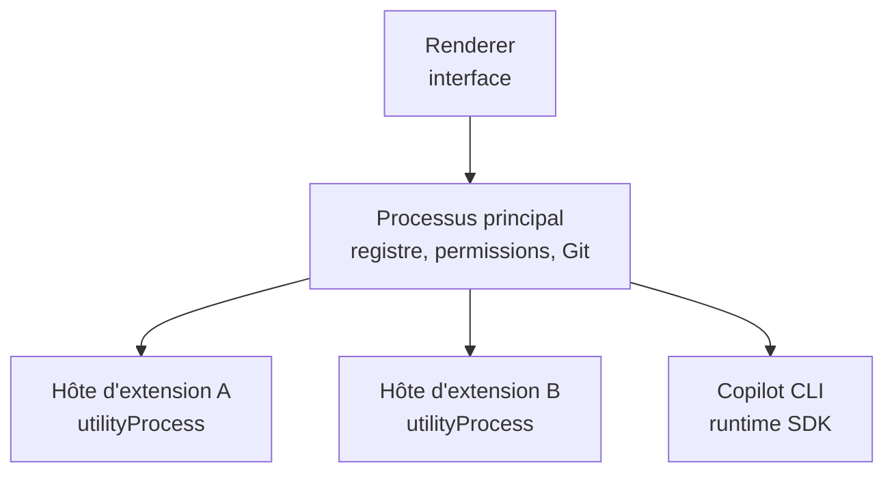
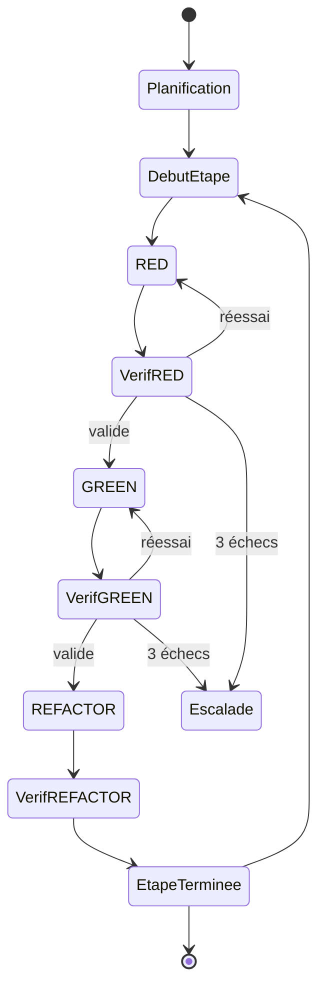

# Architecture technique — application chat Copilot SDK

22/09/2026 · Samir

## 1. Vue d'ensemble

Application de bureau Electron offrant une interface de chat au-dessus du Copilot SDK (`@github/copilot-sdk`), extensible par des extensions tierces qui contribuent des commandes, des agents, des skills, des outils et des panneaux.

Deux publics sont servis par la même application : les non-développeurs, avec une assistance guidée, Git masqué et des permissions en langage clair ; les développeurs, avec accès au détail des appels d'outils, des diffs, des sessions d'agents et des journaux.

### Principes directeurs

| # | Principe | Conséquence architecturale |
| --- | --- | --- |
| P1 | Le code décide, le LLM propose | Les workflows critiques sont des machines à états déterministes |
| P2 | Tout est nommé et adressable | Un registre unique indexe commandes, agents, skills et outils |
| P3 | Le code tiers n'est jamais dans un processus de confiance | Un processus isolé par extension, aucune référence directe au SDK |
| P4 | Un seul point d'arbitrage | Toutes les permissions convergent vers un arbitre unique |
| P5 | Toute action est réversible | Checkpoint Git avant chaque tâche, annulation en un geste |
| P6 | Le contexte est transmis, pas supposé | Chaque session d'agent reçoit un dossier de passation explicite |

### Périmètre

Inclus : coquille applicative, hôte d'extensions, registre de capacités, moteur de tâches, arbitre de permissions, service Git, format de paquet d'extension.

Hors périmètre à ce stade : marketplace en ligne, synchronisation multi-postes, édition collaborative, fournisseurs de modèles autres que Copilot.

### Dépendances externes

- `@github/copilot-sdk` et le binaire Copilot CLI, empaqueté avec l'application et épinglé à une version testée.
- Authentification GitHub de l'utilisateur : elle conditionne l'accès aux modèles et la consommation de son quota.
- Git, présent sur le poste ou embarqué.

## 2. Modèle de processus

Quatre catégories de processus, avec une frontière de confiance entre le processus principal et tout le reste.



Une extension ne parle jamais au runtime Copilot ni au disque : tout passe par le processus principal.

| Processus | Contenu | Confiance | Isolation |
| --- | --- | --- | --- |
| Renderer | Interface, rendu du chat et des panneaux | Code de l'application | `contextIsolation` activé, `nodeIntegration` désactivé, `sandbox`, CSP stricte |
| Principal | Registre, routeur, arbitre de permissions, moteur de tâches, service Git, client SDK | Confiance totale | Seul processus autorisé à écrire sur le disque et à appeler le SDK |
| Hôte d'extension | Une extension tierce, un processus chacune | Non fiable | `utilityProcess.fork()`, modèle de permissions Node, budget mémoire et délai par appel |
| Runtime Copilot | Binaire CLI lancé par le SDK | Fournisseur | Piloté en JSON-RPC, jamais exposé aux extensions |

### Communication

- Renderer ↔ principal : IPC Electron via un preload minimal exposant des canaux nommés par `contextBridge`. Chaque message est validé côté principal (schéma, taille, origine).
- Principal ↔ hôte d'extension : `MessagePort` de `utilityProcess`, protocole requête/réponse avec identifiant d'appel, délai maximal et annulation.
- Principal ↔ runtime Copilot : JSON-RPC 2.0 par stdio, géré par le SDK.

### Politique de redémarrage

Un hôte d'extension qui plante, dépasse son budget mémoire ou son délai est tué puis relancé, au plus trois fois par heure. Au-delà, l'extension est désactivée pour la session et l'utilisateur est prévenu, en nommant l'extension fautive. Une extension défaillante ne doit jamais interrompre le chat ni une tâche en cours.

## 3. Cœur applicatif

Cinq services vivent dans le processus principal. Ils ne connaissent pas les extensions individuellement : ils manipulent des capacités déclarées.

### 3.1 Registre des capacités

Indexe par nom tout ce que les extensions contribuent : commandes, agents, skills, outils, panneaux, serveurs MCP. Un nom est unique et préfixé par l'identifiant de l'extension (`diabeo.tdd/verify_red`), avec un alias court quand il n'y a pas de collision. Le registre est la seule source consultée pour composer une session.

### 3.2 Routeur d'intention

Décide, pour chaque message entrant, ce qui s'exécute.

| Entrée | Destination |
| --- | --- |
| `/nom …` | Handler de commande de l'extension propriétaire |
| `@agent …` | Session de tâche avec l'agent nommé |
| Texte libre | Session de chat principale, enrichie des capacités actives |
| Clic sur une action de panneau | Handler déclaré par le panneau |

Le routeur refuse une commande dont l'extension est désactivée ou dont les permissions ne sont pas accordées, et l'explique dans le chat.

### 3.3 Gestionnaire de sessions

Distingue deux natures de sessions.

- **Session de chat principale** : longue, persistante, visible par l'utilisateur, reprise au lancement de l'application avec `resumeSession`.
- **Sessions de tâche** : éphémères, créées avec un rôle et un périmètre restreints, fermées avec `disconnect` puis supprimées côté runtime.

Le gestionnaire tient un inventaire des sessions ouvertes, applique une limite de parallélisme et purge les sessions orphelines au démarrage. Sans cette purge, chaque cycle de tâche laisse des dizaines de sessions sur le disque.

### 3.4 Bus d'événements et journal

Une timeline unique agrège messages, appels d'outils, sous-tâches, décisions de permission et transitions de tâches. Elle sert quatre usages : affichage, reprise après redémarrage, audit, et résumé renvoyé à la session principale. Chaque entrée porte l'extension et la session d'origine.

### 3.5 Service d'espace de travail

Seul composant autorisé à toucher le disque et Git. Il expose la lecture et l'écriture de fichiers sous la racine du projet, les checkpoints, le diff, le commit et l'annulation. Les extensions n'appellent jamais Git directement, ce qui garantit qu'un retour en arrière reste toujours possible.

## 4. Modèle d'extension

Une extension est un dossier signé contenant un manifeste, du code JavaScript et ses ressources (rôles d'agents, skills, icônes).

### 4.1 Manifeste

```json
{
  "id": "diabeo.tdd",
  "version": "1.0.0",
  "publisher": "diabeo",
  "engines": { "appApi": "^1.2" },
  "main": "dist/index.js",
  "activationEvents": ["onCommand:tdd", "onAgent:tdd-test"],
  "permissions": ["fs:read", "fs:write:src", "fs:write:tests", "git:commit", "shell:test", "copilot:sessions"],
  "contributes": {
    "commands": [{ "name": "tdd", "title": "Implémenter en TDD", "handler": "runTdd" }],
    "agents": [{ "name": "tdd-test", "role": "roles/test.md", "tools": ["report_phase"], "write": "tests/**" }],
    "skills": [{ "name": "tdd-cycle", "path": "skills/tdd-cycle" }],
    "tools": [{ "name": "verify_red", "handler": "verifyRed", "description": "Vérifie qu'un test échoue pour la bonne raison" }],
    "panels": [{ "id": "tdd.progress", "title": "Progression TDD" }],
    "tasks": [{ "name": "tdd-cycle", "handler": "tddTask" }]
  }
}
```

`permissions` est contraignant : une capacité non déclarée est refusée à l'exécution, même si l'utilisateur l'autorise ponctuellement.

### 4.2 Cycle de vie

1. **Installation** : vérification de la signature, contrôle de compatibilité `engines.appApi`, affichage des permissions en langage clair, accord de l'utilisateur.
2. **Enregistrement** : le manifeste est lu au démarrage, les contributions sont indexées dans le registre sans charger le code.
3. **Activation** : au premier événement déclencheur, l'hôte démarre le processus et appelle `activate(ctx)`.
4. **Désactivation** : `deactivate()` est appelé, puis le processus est arrêté après un délai de grâce.

### 4.3 API `ctx`

Seule surface visible depuis une extension. Tous les appels sont sérialisés, tracés et soumis à l'arbitre de permissions.

| Espace de noms | Méthodes principales | Permission requise |
| --- | --- | --- |
| `ctx.chat` | `registerCommand`, `stream`, `progress`, `confirm`, `pick` | aucune |
| `ctx.copilot` | `runAgent(name, prompt)`, `ask(prompt)`, `listModels` | `copilot:sessions` |
| `ctx.workspace` | `readFile`, `writeFile`, `listFiles`, `run(cmd)`, `checkpoint`, `diff` | `fs:*`, `shell:*` |
| `ctx.git` | `commit`, `branch`, `revertTo` | `git:*` |
| `ctx.tools` | `register(tool)` | aucune |
| `ctx.hooks` | `onPreToolUse`, `onPostToolUse` | aucune |
| `ctx.tasks` | `start(name, input)`, `onProgress`, `cancel` | selon la tâche |
| `ctx.panels` | `update(id, data)`, `onAction` | aucune |
| `ctx.storage` | `get`, `set` (espace privé à l'extension) | aucune |
| `ctx.settings` | `get`, `onChange` | aucune |

Règle absolue : `ctx.copilot` ne renvoie jamais un objet `CopilotSession` du SDK, seulement des résultats sérialisés. Exposer la session permettrait à l'extension d'enregistrer ses propres hooks, de lire n'importe quel fichier via les outils intégrés et de contourner l'arbitre.

## 5. Agents, skills et outils nommés

Trois types de capacités que le LLM peut mobiliser, avec des rôles distincts.

| Capacité | Ce que c'est | Qui l'invoque | Effet sur la session |
| --- | --- | --- | --- |
| Agent | Un rôle, un périmètre, un jeu d'outils | L'utilisateur (`@nom`), le code, ou le LLM par délégation | Crée une session de tâche isolée |
| Skill | Un dossier `SKILL.md` décrivant une procédure | Le LLM, quand la tâche correspond à sa description | Charge des instructions dans le contexte |
| Outil | Une fonction appelable avec un schéma d'entrée | Le LLM | Exécute du code dans l'hôte de l'extension |

### 5.1 Résolution par nom

À la création d'une session, le gestionnaire interroge le registre et compose la configuration :

- les **outils** deviennent des `defineTool` dont le handler appelle l'extension propriétaire par RPC ;
- les **agents** sont passés en agents personnalisés du SDK, ou instanciés comme sessions dédiées selon le mode d'invocation ;
- les **skills** sont exposées au runtime via leurs dossiers, et leur description permet au modèle de les choisir seul ;
- les **serveurs MCP** déclarés sont ajoutés à la configuration de session.

Une extension peut demander une session restreinte à certaines capacités : `ctx.copilot.runAgent("tdd-test", prompt, { skills: ["tdd-cycle"] })`. Le registre ne fournit que ce que l'extension a le droit d'utiliser.

### 5.2 Convention de nommage

Nom complet `<extension>/<capacité>`, alias court sans préfixe tant qu'il n'y a pas de collision. En cas de collision, l'alias court est refusé aux deux extensions et le chat affiche les noms complets. Les noms sont stables entre versions : renommer une capacité est une rupture d'API pour les extensions qui en dépendent.

### 5.3 Outils terminaux

Un outil déclaré `isTerminal: true` met fin au tour de l'agent dès son appel réussi. C'est le mécanisme recommandé pour qu'un agent rende un résultat structuré, plutôt que du texte libre à analyser : `report_phase`, `submit_plan`, `return_result`. Le schéma de l'outil sert alors de contrat entre le LLM et le code appelant.

## 6. Moteur de tâches

Une tâche est un workflow long, déterministe et reprenable. Les extensions ne codent pas leur propre boucle : elles fournissent une définition que le moteur exécute.

### 6.1 Contrat

Une définition de tâche fournit un état initial, un réducteur pur `transition(state, event)` renvoyant le nouvel état et une liste d'effets, et un exécuteur d'effets. Le moteur apporte la persistance, la progression, l'annulation, les délais et la reprise après redémarrage.

Cette séparation permet de tester toute la logique sans LLM, sans Git et sans disque.

### 6.2 Cas de référence : cycle TDD

Trois agents (planificateur, test, développement), un orchestrateur qui est du code.



Les portes de vérification sont exécutées par le code, jamais rapportées par un agent.

| Porte | Contrôles |
| --- | --- |
| Vérif RED | Seuls des fichiers de test modifiés ; exactement un nouveau test ; il échoue sur une assertion ou un symbole manquant ; aucune régression |
| Vérif GREEN | Empreinte des fichiers de test inchangée ; seuls des fichiers de production modifiés ; suite entièrement verte, aucun test ignoré |
| Vérif REFACTOR | Mêmes contrôles ; en cas d'échec, retour au commit vert sans escalade |

Chaque transition produit un commit Git, ce qui donne un historique auditable par étape : `test:`, puis `feat:`, puis éventuellement `refactor:`.

### 6.3 Contexte transmis aux agents

Chaque phase ouvre une session neuve. Le contexte utile est transmis explicitement : plan, étape en cours, résumés des phases précédentes, raison du rejet en cas de réessai. L'état partagé réel reste le dépôt lui-même, que chaque agent relit.

Une session persistante par rôle est une option de réglage. Elle réduit l'exploration redondante, au prix d'une compaction imprévisible du contexte et d'un attachement aux pistes abandonnées.

### 6.4 Restitution

À la fin, le moteur produit un résultat structuré : issue, étapes avec leur statut et leurs commits, fichiers modifiés, état final de la suite de tests, branche, durée et nombre de requêtes consommées.

Deux restitutions en découlent : une carte de bilan pour l'utilisateur, avec les actions voir le diff, relancer une étape ou tout annuler ; et un résumé compact pour la session de chat principale, injecté comme résultat d'outil si le LLM a lancé la tâche, ou comme contexte additionnel du message suivant si l'utilisateur l'a lancée par une commande. Les transcriptions des sessions de tâche ne sont jamais réinjectées.

## 7. Sécurité et permissions

Le modèle de menace part du principe qu'une extension installée peut être malveillante ou compromise par une mise à jour.

### 7.1 Menaces et parades

| Menace | Parade |
| --- | --- |
| Exfiltration de code source ou de secrets | Réseau refusé par défaut aux hôtes d'extensions, domaines autorisés déclarés dans le manifeste |
| Écriture hors périmètre | Chemins normalisés et vérifiés dans le service d'espace de travail, modèle de permissions Node en second rempart |
| Contournement par le shell | Liste blanche de commandes, refus des redirections et des commandes Git |
| Consommation du quota Copilot | Compteur par extension, plafond par session et par heure, visible par l'utilisateur |
| Injection de prompt via un fichier ou une page web | Contenu externe traité comme données ; une action sensible déclenchée par ce contenu demande confirmation |
| Escalade via les hooks | Les hooks des extensions ne peuvent que refuser ou restreindre, jamais élargir une permission |
| Extension qui bloque l'application | Isolation par processus, délai maximal par appel, redémarrage automatique |

### 7.2 Arbitre de permissions

Un seul arbitre, dans le processus principal, évalue chaque demande dans cet ordre :

1. **Périmètre du manifeste** : hors périmètre, refus immédiat, sans question à l'utilisateur.
2. **Règles de l'utilisateur** : décisions mémorisées (« toujours autoriser les tests sur ce projet »).
3. **Politique par défaut** : prudente pour le profil non-développeur, permissive pour le profil développeur.
4. **Demande à l'écran** : formulée en langage clair, avec le nom de l'extension, l'action et la cible.

Les sessions du SDK reçoivent un `onPermissionRequest` unique fourni par l'arbitre. Les extensions n'en enregistrent jamais.

### 7.3 Chaîne de hooks

Plusieurs extensions peuvent observer les appels d'outils d'une même session. Le processus principal les exécute en série, avec un délai maximal par hook. Le premier refus l'emporte. Un hook qui expire ou lève une exception est neutralisé sans bloquer la session, et l'incident est journalisé avec le nom de l'extension.

Point de vigilance : côté SDK, une exception dans un hook est journalisée puis le comportement par défaut reprend. Un refus qui plante devient donc une autorisation implicite. Chaque handler est enveloppé dans un `try`/`catch` dont la branche d'erreur refuse.

### 7.4 Durcissement Electron

- `contextIsolation: true`, `nodeIntegration: false`, `sandbox: true` sur toutes les fenêtres.
- Preload minimal exposant uniquement des canaux nommés par `contextBridge`, avec validation de schéma côté principal.
- CSP stricte, navigation externe interdite, ouverture des liens dans le navigateur système.
- Aucune donnée sensible dans le renderer : les jetons GitHub restent dans le processus principal, stockés via le trousseau du système.

## 8. Distribution et versionnement

### 8.1 Format de paquet

Archive ZIP contenant le manifeste, le code compilé, les ressources et un fichier de signature. La signature couvre l'intégralité de l'archive et est vérifiée à l'installation puis à chaque mise à jour. Une extension non signée n'est installable qu'en mode développeur, avec un avertissement permanent dans l'interface.

### 8.2 Versionnement de l'API

L'API `ctx` suit le versionnement sémantique, déclaré dans `engines.appApi`. Une extension déclarant `^1.2` est refusée par une application exposant l'API 2.0. Les capacités dépréciées restent fonctionnelles pendant deux versions mineures, avec un avertissement dans les journaux de l'extension.

Geler l'API avant d'avoir écrit deux ou trois extensions réelles est le piège principal : la version 1.0 publique ne devrait arriver qu'après validation par des usages variés.

### 8.3 Installation et mises à jour

Sources d'installation : fichier local, URL directe, et plus tard un registre en ligne. La mise à jour est explicite par défaut ; l'automatique est réservée aux éditeurs que l'utilisateur a marqués comme fiables. Une mise à jour qui élargit les permissions demandées exige un nouvel accord.

### 8.4 Désactivation à distance

L'application interroge périodiquement une liste de révocation signée, contenant les identifiants et versions d'extensions reconnues malveillantes. Une extension révoquée est désactivée au prochain lancement, avec un message expliquant pourquoi. Ce mécanisme doit exister dès la première version publique : il ne peut pas être ajouté après coup pour les postes déjà déployés.

## 9. Interface

Une seule application, deux niveaux de lecture, réglables à tout moment et pas seulement à l'installation.

| Aspect | Mode simple | Mode avancé |
| --- | --- | --- |
| Activité des agents | « Écriture du test en cours… » | Journal des appels d'outils, arguments, durées |
| Modifications | « 3 fichiers modifiés », boutons accepter ou annuler | Diff complet, fichier par fichier |
| Git | Masqué, checkpoints automatiques | Branches, commits et historique accessibles |
| Permissions | Question en langage clair, mémorisation proposée | Règle détaillée par extension et par chemin |
| Erreurs | Message explicatif et action suggérée | Trace technique et journal de l'extension |

Les extensions fournissent pour chaque action un titre court et une description en langage naturel ; l'interface choisit le niveau de détail. Une extension qui n'expose que des messages techniques est inutilisable par une partie du public visé : c'est un critère de validation à l'entrée du registre.

Les sessions d'agents peuvent être affichées comme des onglets secondaires, montrant en direct ce que fait chaque agent. C'est une aide à la confiance pour les non-développeurs et un outil de débogage pour les développeurs.

## 10. Feuille de route et décisions ouvertes

### 10.1 Ordre de construction

| Jalon | Contenu | Critère de sortie |
| --- | --- | --- |
| J1 | Coquille Electron, chat sur la session principale, service Git | Une conversation complète avec checkpoints et annulation |
| J2 | Registre, routeur, API `ctx` avec une extension interne codée en dur (TDD) | Le cycle TDD tourne de bout en bout via `/tdd` |
| J3 | Moteur de tâches générique extrait de l'orchestrateur TDD | Deux tâches différentes partagent le même moteur |
| J4 | Isolation en `utilityProcess` et arbitre de permissions | L'extension TDD tourne hors du processus principal, sans perte de fonction |
| J5 | Format de paquet signé, installation, révocation | Une extension tierce s'installe depuis un fichier |
| J6 | Mode simple, formulation des permissions, onglets d'agents | Un utilisateur non développeur mène une tâche sans aide |

Écrire l'extension TDD en interne avant d'ouvrir l'API est délibéré : elle sert de banc d'essai et révèle les manques de `ctx` avant qu'un tiers ne dépende d'une surface figée.

### 10.2 Décisions ouvertes

- [ ] Langage des extensions : JavaScript seul, ou tout exécutable parlant le protocole RPC (ouvre à Python et Swift, complique la distribution).
- [ ] Niveau d'isolation cible : `utilityProcess` avec permissions Node, ou conteneur système pour les extensions non fiables.
- [ ] Politique de quota : plafond global, par extension, ou compteur informatif seulement.
- [ ] Stockage de l'état des tâches : fichiers JSON dans le projet, ou base locale SQLite dans le profil utilisateur.
- [ ] Portabilité du format d'extension vers Claude Code, dont les plugins ont une structure proche.

### 10.3 Risques principaux

| Risque | Impact | Atténuation |
| --- | --- | --- |
| API `ctx` figée trop tôt | Ruptures en cascade chez les tiers | Ne publier la 1.0 qu'après J5, marquer l'API expérimentale avant |
| Dépendance à une version du Copilot CLI | Fonctions cassées par une mise à jour | Version épinglée et embarquée, tests de non-régression par version |
| Noms d'outils intégrés variables | Gardes de permissions inopérantes | Détection au démarrage par journalisation, et non en dur dans le code |
| Coût en requêtes des tâches longues | Quota utilisateur épuisé | Plafonds, estimation avant lancement, reprise plutôt que relance complète |
