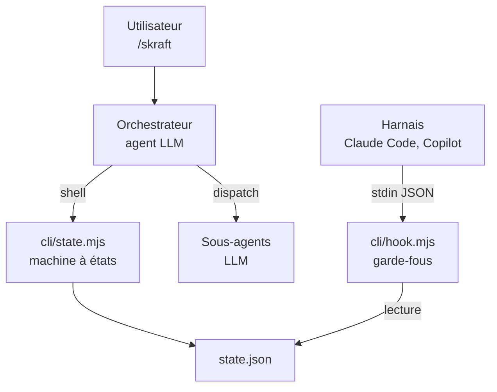

# Analyse technique de skraft-plugin

22/09/2026 · Samir

## Synthèse

skraft transforme un assistant de code en pipeline SDLC en quatre phases (RESEARCH → DESIGN → DISTILL → DELIVER), piloté par un orchestrateur LLM et encadré par huit garde-fous déclenchés par les hooks du harnais. La conception est solide : politiques pures sans dépendance, modes fail-closed et fail-open raisonnés, audit JSONL, état modifié par un CLI transactionnel.

Constat principal : les 787 tests passent, mais le contrat entre le harnais et les hooks n'est pas couvert. À l'exécution avec des payloads réalistes, les gardes liés au pipeline (G1, G4, G5, G6) ne se déclenchent pas, et le cycle de phases documenté n'est pas réalisable avec le CLI d'état. Le déterminisme effectif repose aujourd'hui sur le CLI d'état et sur l'obéissance du LLM à ses instructions.

Toutes les observations portent sur la version 1.5.2 du plugin, branche `main` clonée le 22 septembre 2026.

## Structure du dépôt

Environ 1 050 fichiers, dont 60 fichiers JavaScript (4 100 lignes) constituent le seul code exécuté. Le reste est du contenu destiné au LLM ou de l'outillage du dépôt.

| Zone | Contenu | Rôle |
| --- | --- | --- |
| `plugins/skraft-framework/src/` | 60 fichiers `.mjs` en architecture hexagonale : `domain/`, `application/`, `ports/`, `adapters/`, `cli/` | Runtime : hooks, état, CLI |
| `plugins/skraft-framework/agents/` | 22 agents : orchestrateur, spécialistes, reviewers, lentilles, workers | Prompts LLM |
| `plugins/skraft-framework/skills/` | 36 skills `SKILL.md` avec références et scripts | Procédures chargées par les agents |
| `plugins/skraft-framework/instructions/` | 3 fichiers : état, artefacts, synchronisation des todos | Règles de manipulation de l'état données au LLM |
| `tests/skraft-framework/` | 67 fichiers, 787 tests | Tests unitaires et d'acceptation des services |
| `.github/`, `.agents/`, `docs/` | Agents de documentation, workflows CI, skill « genesis », site | Outillage du dépôt, hors plugin |

## Points d'entrée

Trois points d'entrée, déclenchés par trois acteurs différents.



L'orchestrateur conduit le pipeline, le CLI d'état est seul autorisé à écrire l'état, et les hooks lisent cet état pour autoriser ou refuser.

### 1. `/skraft` → l'orchestrateur

L'utilisateur lance l'agent `Skraft - Orchestrator`, un prompt de 300 lignes. Il détermine le slug du projet, initialise ou relit l'état, évalue la difficulté, dispatche les sous-agents et enregistre leurs verdicts via le CLI d'état. Toute la conduite du pipeline est confiée au LLM.

### 2. `src/cli/state.mjs` → le pont déterministe vers l'état

Appelé en shell par l'orchestrateur : `init`, `get`, `record-verdict`, `record-artifact`, `record-review-artifact`, `transition`, `close-phase`, `set-difficulty`, `incr-retry`. Chaque commande passe par `state-service` puis `domain/state-machine.mjs`, qui applique les invariants, écrit `state.json` de façon atomique et conserve jusqu'à trois sauvegardes.

### 3. `src/cli/hook.mjs` → les garde-fous

Appelé par le harnais à chaque événement déclaré dans les manifestes, avec le payload sur stdin et l'événement en argument.

```
hooks.json → node hook.mjs PreToolUse Agent
  → payload.mjs : normalisation des clés en camelCase
  → hook-router.mjs : aiguillage par événement
  → service applicatif : composite PreToolUse, SubagentStart, SubagentStop, PostToolUse
  → politique pure dans domain/
  → stdout : {"decision":"allow|deny|block|additionalContext", ...}
```

À côté, l'événement `SessionStart` lance `cli/housekeeping.mjs`, qui purge le journal d'audit et les sauvegardes d'état expirées. Il termine toujours avec le code 0.

## Fichiers de contrôle

| Fichier | Rôle | Écrit par |
| --- | --- | --- |
| `com.anthropic.claude-code/hooks/hooks.json` | Câblage des hooks pour Claude Code : SessionStart, PreToolUse (Agent, Bash), SubagentStart, SubagentStop, PostToolUse (Agent, Read) | Versionné |
| `com.github.copilot/hooks/hooks.json` | Même câblage pour Copilot installé en plugin, commandes `bash` et `powershell` | Versionné |
| `.github/hooks/skraft-framework.json` | Même câblage pour Copilot sur un checkout du dépôt, chemins relatifs | Versionné |
| `plugins/skraft-framework/skraft-framework.config.json` | `phaseOrder`, agents par phase, skills obligatoires par agent, artefacts attendus par agent | Généré par `cli/build-config.mjs` |
| `skraft-config.json` (racine du projet) | `depthTier`, `trackingLayout` | `cli/config.mjs` |
| `.copilot-tracking/skraft-plans/{slug}/state.json` | Phase courante, verdicts, artefacts, compteurs de réessais | `cli/state.mjs`, plus deux champs modifiés directement par l'orchestrateur |
| `logs/skill-audit.jsonl` | Journal append-only de toutes les décisions des gardes | Les hooks |
| `reviews/…/*.md` | Rapports des reviewers, avec une ligne `**Verdict:** …` | Les agents reviewers |

Le manifeste Copilot déclare aujourd'hui les six routes, contrairement au README du framework qui le décrit encore comme incomplet.

## Contrôles

### Garde-fous déclenchés par les hooks

| Garde | Événement | Ce qu'il vérifie | Mode | Code |
| --- | --- | --- | --- | --- |
| G1 | PreToolUse (Agent) | L'agent dispatché est celui attendu, calculé depuis `state.json` | fail-closed | `pipeline-policy.mjs`, `pre-tool-use-service.mjs` |
| G2 | SubagentStart | Injecte la liste des skills obligatoires dans le contexte du sous-agent | fail-open | `skill-policy.mjs`, `subagent-start-service.mjs` |
| G3 | PostToolUse (Read) et SubagentStop | Journalise les lectures de `SKILL.md` ; à la fin, bloque si une skill obligatoire n'a pas été lue | fail-open | `skill-policy.mjs`, `post-tool-use-service.mjs`, `subagent-stop-service.mjs` |
| G4 | SubagentStop | Les artefacts attendus pour cet agent sont enregistrés dans l'état | fail-closed | `artifact-policy.mjs`, `subagent-stop-service.mjs` |
| G5 | SubagentStop | Le verdict écrit dans le rapport du reviewer correspond au verdict enregistré ; en DELIVER, l'arbre Git est propre | fail-closed | `artifact-policy.mjs`, `git-commit-verifier.mjs` |
| G6 | PostToolUse (Agent) | Injecte à l'orchestrateur l'agent suivant, un ordre de relance ou d'escalade | fail-open | `pipeline-policy.mjs`, `post-tool-use-service.mjs` |
| G7 | PreToolUse (Bash) | Interdit toute écriture directe dans `state.json` ou le journal d'exécution | fail-closed | `session-guard-policy.mjs` |
| G8 | PreToolUse | En DELIVER, interdit d'écrire dans `src/` ou `tests/` hors de l'agent DELIVER surveillé | fail-open si l'état est illisible | `session-guard-policy.mjs` |

Les décisions PreToolUse sont combinées par `pre-tool-use-composite.mjs` avec la priorité `block` > `deny` > `allow`. G1 n'y est exécuté que si le payload contient `projectSlug` et un agent demandé.

### Invariants de la machine à états

Appliqués par `domain/state-machine.mjs` à chaque commande du CLI d'état.

| Invariant | Règle |
| --- | --- |
| I1 | Avancer exige un verdict APPROVED pour la phase courante |
| I2 | La phase cible doit être exactement la suivante, pas de saut |
| I3 | Le compteur de réessais est plafonné par `maxRetriesPerPhase` (2 par défaut) |
| I4 | `phasesCompleted` est append-only |
| I5 | `phaseArtifacts` est append-only |
| I6 | `reviewArtifacts` est append-only |
| I7 | `difficulty` n'est écrit qu'une fois |
| I8 | DONE est terminal : toute mutation est refusée |
| I9 | L'état est validé et normalisé avant toute transition |

`close-phase` combine enregistrement du verdict, de l'artefact de revue et avancée dans une seule écriture atomique, pour les phases sans reviewer ou les clôtures manuelles.

## Constats à l'exécution

Les tests appellent les services avec des payloads idéaux. En exécutant `hook.mjs` et `state.mjs` comme le ferait un harnais, sept décrochages apparaissent.

| # | Constat | Effet | Gravité |
| --- | --- | --- | --- |
| C1 | G1, G4, G5, G6 exigent `projectSlug` dans le payload, que ni Claude Code ni Copilot n'envoient | Ces gardes ne s'exécutent jamais ; G8 passe en fail-open | Haute |
| C2 | G1 et G6 valident `specialistDone`, `reviewerVerdict`, `retries`, `skipPhases`, alors que le CLI écrit `verdicts`, `retryCount`, `phasesCompleted` | Si `projectSlug` est fourni, tout dispatch d'agent du pipeline est bloqué | Haute |
| C3 | `init` crée l'état en `DISCOVER` ; la machine à états suit DISCOVER → DISCUSS → DESIGN → DISTILL → DELIVER, la configuration RESEARCH → DESIGN → DISTILL → DELIVER | `close-phase --phase RESEARCH` échoue ; clore DISCOVER mène à DISCUSS | Haute |
| C4 | Les manifestes ne routent `PreToolUse` que pour `Agent` et `Bash` ; côté Copilot, les outils s'appellent `bash` et `edit` | `Write` et `Edit` ne sont jamais contrôlés ; G7 ne détecte rien sous Copilot | Haute |
| C5 | Sortie `{"decision":"deny","message":…}` avec code 0 ; le SDK Copilot définit `permissionDecision` et `additionalContext`, Claude Code un format équivalent dans `hookSpecificOutput` | Refus de G7 et injections de G2 et G6 probablement ignorés, à confirmer par harnais | Haute |
| C6 | Les rapports écrivent `APPROVED`, `NEEDS_REWORK`, `REJECTED` ; l'état n'accepte que `APPROVED`, `CHANGES_REQUESTED` | G5 bloquerait tout verdict autre qu'APPROVED | Moyenne |
| C7 | Le contrôle des skills attend un transcript en tableau dans le payload, les harnais fournissent un chemin ; G3 lit `toolInput.path`, l'outil Read de Claude Code utilise `file_path` | Contrôle des skills en fail-open permanent | Moyenne |

Deux points mineurs : le « commit vérifié » de G5 signifie seulement un arbre Git propre, un agent inactif passe donc la porte ; et `housekeeping.mjs` ignore le réglage `trackingLayout` pour trouver l'état.

L'orchestrateur est explicitement invité à modifier directement `entryPoint` et `adrRatification` dans `state.json`. Cela fonctionne uniquement parce que l'outil d'édition n'est pas surveillé (C4) : corriger C4 casserait ce chemin.

### Reproduction

Depuis la racine du dépôt cloné, dans un répertoire Git vide :

```bash
export SKRAFT_TRACKING_ROOT=/tmp/sk/track
S=plugins/skraft-framework/src/cli/state.mjs
H=plugins/skraft-framework/src/cli/hook.mjs

# C3 : état créé en DISCOVER, RESEARCH refusé
node $S init --slug demo
node $S close-phase --slug demo --phase RESEARCH --verdict APPROVED
# → {"code":"PHASE_MISMATCH",...}

# C1 : payload de type Claude Code, G1 ignoré
echo '{"hook_event_name":"PreToolUse","tool_name":"Agent","tool_input":{"subagent_type":"Skraft - Software Engineer"}}' \
  | node $H PreToolUse Agent
# → {"decision":"allow"}

# C2 : avec projectSlug, blocage sur un état valide
echo '{"projectSlug":"demo","toolInput":{"subagentType":"Skraft - Software Engineer"}}' \
  | node $H PreToolUse Agent
# → {"decision":"block","message":"...invalid in field(s): specialistDone, reviewerVerdict, retries, skipPhases"}

# C4 : outil edit de Copilot, aucune détection
echo '{"toolName":"edit","toolArgs":"{\"path\":\"state.json\"}"}' | node $H PreToolUse Agent
# → {"decision":"allow"}
```

## Recommandations

Classées par ordre de traitement : chaque correction rend les suivantes vérifiables.

1. **Unifier le modèle d'état (C2, C3).** Un seul schéma, un seul validateur, lu par les hooks comme par le CLI. Dériver `specialistDone`, `reviewerVerdict` et `retries` depuis `verdicts`, `phaseArtifacts` et `retryCount` plutôt que de les attendre dans le fichier. Faire lire `phaseOrder` depuis la configuration par la machine à états, et initialiser l'état sur la première phase de cette liste.
2. **Résoudre le slug sans le payload (C1).** Les hooks ne recevront jamais `projectSlug`. Le déduire du répertoire courant : un état actif unique sous le dossier de suivi, ou un fichier pointeur `active.json` écrit par `state.mjs init`.
3. **Émettre le format natif de chaque harnais (C5).** Ajouter dans `decision.mjs` une traduction par harnais : `permissionDecision` et `permissionDecisionReason` pour Copilot, `hookSpecificOutput` pour Claude Code, ou le code de sortie 2 pour un blocage. Choisir le harnais via un argument du manifeste.
4. **Surveiller tous les outils d'écriture (C4).** Router `PreToolUse` pour `Write`, `Edit`, `MultiEdit` côté Claude Code, et normaliser les noms d'outils Copilot (`bash`, `edit`, `create`) avant les politiques. Remplacer en même temps les modifications directes de `entryPoint` et `adrRatification` par des commandes du CLI d'état.
5. **Aligner le vocabulaire des verdicts (C6).** Un seul ensemble, ou une table de correspondance explicite dans `artifact-policy.mjs`.
6. **Lire le vrai transcript (C7).** Charger le fichier désigné par `transcript_path`, et accepter `file_path` comme `path` dans le traceur G3.
7. **Tester le contrat réel.** Ajouter des tests d'acceptance qui rejouent des payloads capturés sur chaque harnais et vérifient la sortie attendue par ce harnais, pas seulement la décision interne. C'est le filet qui aurait détecté C1, C4, C5 et C7.

Point complémentaire pour G5 : vérifier qu'un commit nouveau existe depuis le début de la phase (SHA de départ enregistré dans l'état), pas seulement que l'arbre est propre.

## Méthode et sources

Dépôt cloné (`git clone --depth 1`, branche `main`, plugin en version 1.5.2), lecture intégrale du runtime `src/`, des trois manifestes de hooks, de la configuration générée et du prompt de l'orchestrateur. Suite de tests exécutée avec `node --test tests/skraft-framework/*.test.mjs` : 787 tests, 786 réussis, 1 ignoré. Les constats C1 à C4 ont été reproduits en exécutant les CLI. C5 compare la sortie du plugin aux types de hooks du Copilot SDK (`@github/copilot-sdk`) et au format documenté de Claude Code ; il reste à confirmer sur chaque harnais en conditions réelles.

- [skraft-plugin sur GitHub](https://github.com/SebastienDegodez/skraft-plugin)
- [README du framework skraft-framework](https://github.com/SebastienDegodez/skraft-plugin/blob/main/plugins/skraft-framework/README.md)
