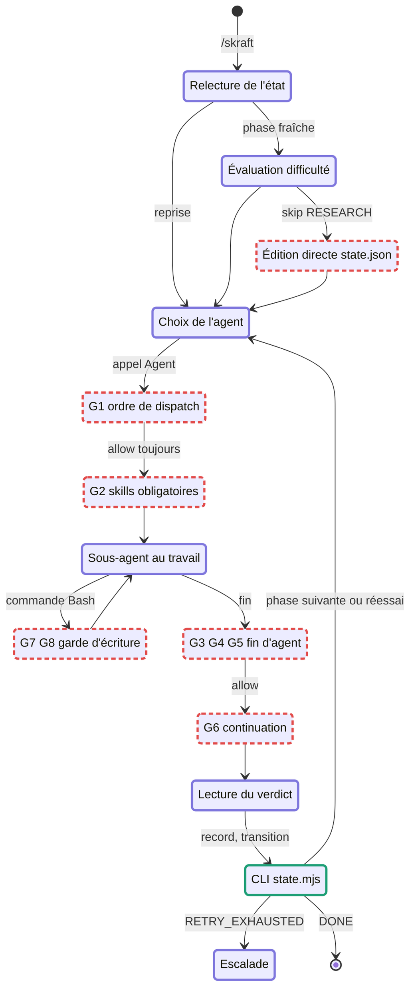
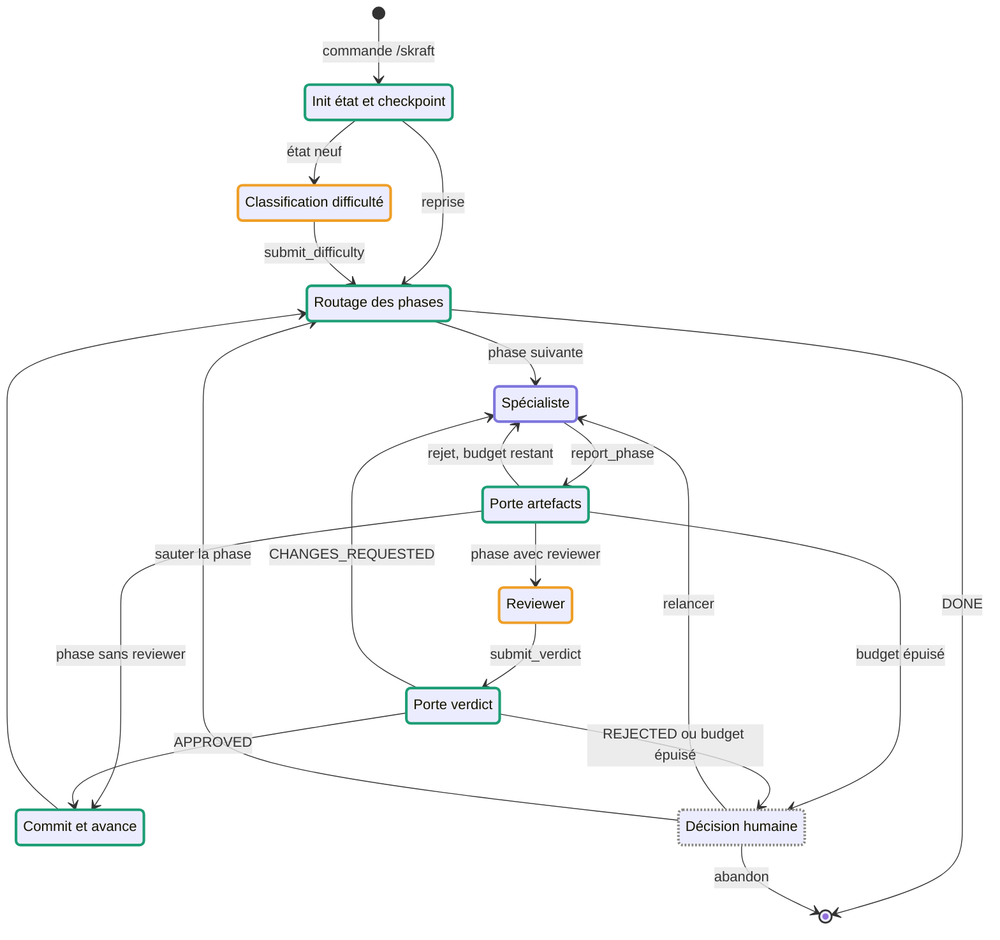
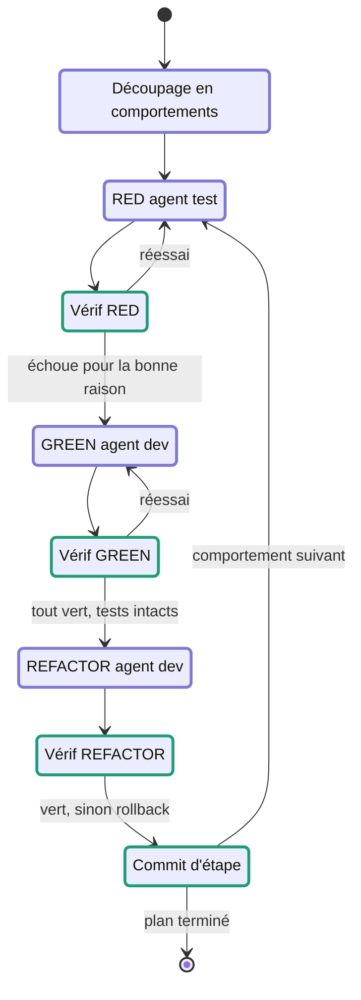

# skraft : diagrammes d'état comparés

22/09/2026 · Samir

Dans skraft-plugin, c'est le LLM orchestrateur qui décide chaque transition, et les hooks censés le contrôler ne se déclenchent pas en conditions réelles. Dans notre approche, un réducteur déterministe décide les transitions et le LLM n'intervient que pour produire des artefacts et des verdicts, toujours vérifiés par du code avant d'avancer.

## Lecture du document

| Bordure | Signification |
| --- | --- |
| Violette | Décision ou production par un LLM |
| Verte | Code déterministe, vérifiable et testable |
| Rouge, pointillée | Contrôle prévu mais inopérant ou erroné en conditions réelles |
| Orange | Risque résiduel assumé : LLM dont la sortie est vérifiée mais reste un jugement |
| Grise, pointillée | Décision humaine |

Les références C1 à C7 renvoient aux constats de l'analyse technique de skraft-plugin (version 1.5.2).

### Hypothèses de départ

- Notre approche reprend les quatre phases de la configuration skraft : RESEARCH → DESIGN → DISTILL → DELIVER, avec RESEARCH sans reviewer.
- Elle tourne dans notre application, au-dessus du Copilot SDK : l'orchestrateur est du code, chaque agent tourne dans une session isolée.
- La phase DELIVER réutilise la machine à états TDD définie précédemment, imbriquée dans le pipeline.
- Les politiques pures de `domain/` de skraft sont reprises quand elles sont correctes ; le modèle d'état est unifié.

## skraft-plugin tel qu'il s'exécute

Seul le CLI d'état est un contrôle déterministe effectif. Toutes les transitions sortant d'un état violet sont décidées par le LLM : l'ordre des agents, l'interprétation du verdict, le passage à la phase suivante. Les six états rouges sont des contrôles prévus qui laissent tout passer en conditions réelles ; l'édition directe de `state.json` contourne le CLI.

Le chemin « skip RESEARCH » est particulièrement fragile : l'orchestrateur écrit `entryPoint.skipPhases` à la main, puis appelle `transition --to DESIGN`, que la machine à états refuse puisqu'elle a initialisé l'état en DISCOVER (C3).

### États de skraft-plugin

| État | Acteur | Entrées | Sorties | Fichiers | Faiblesse |
| --- | --- | --- | --- | --- | --- |
| Relecture de l'état | LLM | `state.mjs get --slug` | Liste de todos dans le contexte du LLM | `state.json` | L'état de travail vit ensuite dans le contexte, pas dans le fichier |
| Évaluation difficulté | LLM + skill | Story `plans/{date}/stories-*.md`, skill `skraft-difficulty-routing` | `state.mjs set-difficulty` | `state.json.difficulty` | Classification subjective, non vérifiée |
| Édition directe `state.json` | LLM | Difficulté | `entryPoint.skipPhases` modifié par l'outil d'édition | `state.json` | Contourne le CLI et ses invariants ; toléré seulement parce que l'édition n'est pas surveillée (C4) |
| Choix de l'agent | LLM | Todos, champs de l'état | Appel de l'outil Agent avec un en-tête de dispatch | — | L'ordre des phases n'est garanti que par le prompt |
| G1 ordre de dispatch | Hook | Payload `tool_input.subagent_type` | `allow` | `skraft-framework.config.json` (non lu) | Ignoré faute de `projectSlug` (C1) ; bloquerait tout sinon (C2) |
| G2 skills obligatoires | Hook | Nom de l'agent | `{"decision":"additionalContext"}` | `agentSkills` de la config, `SKILL.md` | Format probablement non reconnu par le harnais (C5) |
| Sous-agent au travail | LLM | Prompt, skills, artefacts amont | Fichiers dans `research/`, `plans/`, `details/`, `reviews/`, `src/`, `tests/` | Dossier de suivi, dépôt | Aucun périmètre d'écriture effectif |
| G7 G8 garde d'écriture | Hook | Commande Bash | `{"decision":"deny"}` | — | Écritures par `Write`/`Edit` non routées, noms Copilot non reconnus (C4), format de refus (C5) |
| G3 G4 G5 fin d'agent | Hook | Payload sans transcript ni `projectSlug` | `allow` | `logs/skill-audit.jsonl` | Contrôle des skills en fail-open (C7) ; artefacts et verdict jamais vérifiés (C1) |
| G6 continuation | Hook | Payload | `allow` | — | Jamais actif (C1) |
| Lecture du verdict | LLM | Rapport `reviews/…/*.md`, ligne `**Verdict:**` | Traduction `NEEDS_REWORK` → `CHANGES_REQUESTED`, `record-verdict`, `incr-retry` | `state.json.verdicts` | Traduction laissée au LLM (C6) |
| CLI state.mjs | Code | Commandes shell | `state.json` atomique, trois sauvegardes, codes de sortie | `state.json`, sauvegardes | Cycle de phases désaligné (C3) |
| Escalade | LLM | `RETRY_EXHAUSTED` du CLI | Message à l'utilisateur, commentaire GitHub | — | Dépend de l'arrêt effectif du LLM |

## Notre approche

### Pipeline

Toutes les transitions partent d'un état vert ou gris : le LLM ne choisit jamais la suite. Il produit un artefact ou un verdict, que le code valide avant de décider. Le spécialiste de DELIVER est remplacé par la sous-machine TDD ci-dessous.

### Sous-machine DELIVER

La sortie de la sous-machine alimente la Porte artefacts du pipeline, puis le reviewer DELIVER. Les escalades internes (trois échecs sur une vérification) remontent à la Décision humaine du pipeline.

### États de notre approche

| État | Acteur | Entrées | Sorties | Fichiers | Risque résiduel |
| --- | --- | --- | --- | --- | --- |
| Init état et checkpoint | Code | Commande, slug, story | État initial sur la première phase de `phaseOrder`, SHA Git de départ | `.skraft/{slug}/state.json`, configuration | Aucun |
| Classification difficulté | LLM | Story, grille de difficulté | Outil `submit_difficulty` avec un niveau parmi quatre | État | Jugement subjectif ; confirmable par l'utilisateur en mode simple |
| Routage des phases | Code | État, `phaseOrder`, difficulté | Phase suivante, ou DONE ; `skipPhases` calculé par règle | État | Aucun |
| Spécialiste | LLM | Dossier de passation, skills injectées, artefacts amont | Fichiers dans son périmètre, outil `report_phase` | Dossier de suivi | Qualité du contenu, jugée ensuite par le reviewer |
| Porte artefacts | Code | Rapport du spécialiste, état du disque | Accepté, ou rejet motivé avec retour au spécialiste | Motifs d'artefacts attendus, empreintes | Vérifie la forme et le périmètre, pas le fond |
| Reviewer | LLM | Artefacts, critères de revue, lentilles | Rapport écrit, outil `submit_verdict` avec verdict et constats | `reviews/…/*.md` | Le verdict reste un jugement de LLM |
| Porte verdict | Code | Verdict structuré, rapport écrit | Transition APPROVED, relance ou escalade ; compteur de réessais | État | Aucun |
| Commit et avance | Code | Phase validée | Commit Git, nouvelle phase dans l'état, bilan intermédiaire | Dépôt Git, état | Aucun |
| Décision humaine | Humain | Motif d'escalade, historique | Relancer, sauter la phase, abandonner | État, journal | Dépend de la disponibilité de l'utilisateur |
| RED, GREEN, REFACTOR | LLM | Comportement ciblé, retour du vérificateur | Test ou code dans le périmètre de la session | `tests/`, `src/` | Qualité du test ou du code |
| Vérif RED, GREEN, REFACTOR | Code | Résultats du lanceur de tests, diff Git, empreinte des tests | Commit ou rollback, réessai ou escalade | Rapport JSON du lanceur | Dépend de l'analyse correcte de la sortie du lanceur par stack |

Les risques résiduels se concentrent sur trois jugements de LLM : la difficulté, le contenu produit, et le verdict du reviewer. Ils sont encadrés par des sorties structurées et des vérifications de forme, mais un reviewer complaisant peut toujours valider un artefact médiocre.

## Comparaison

| Dimension | skraft-plugin | Notre approche |
| --- | --- | --- |
| Qui choisit l'étape suivante | LLM orchestrateur, guidé par son prompt | Réducteur `transition(state, event)` |
| Nature du contrôle | Négatif : les hooks peuvent refuser, pas ordonner | Positif : le code lance chaque agent et chaque vérification |
| Déclenchement des vérifications | Hooks du harnais, conditionnés au payload | Effets `verify*` exécutés à chaque transition |
| Identification du projet et de l'agent | Attendue dans le payload, absente en pratique | Connue de l'orchestrateur, qui a créé la session |
| Sortie des agents | Fichiers markdown, verdict extrait par regex | Outils terminaux avec schéma (`report_phase`, `submit_verdict`) |
| Écriture de l'état | CLI, plus deux champs modifiés à la main | Seul le runner écrit ; aucune édition par un agent |
| Protection des fichiers | Regex sur les commandes Bash | Périmètre par session, hook sur tous les outils d'écriture, empreinte des tests |
| Réessais et escalade | Le LLM compare les compteurs et décide de s'arrêter | Budget appliqué par le réducteur, escalade vers l'utilisateur |
| Skills | Injection par hook, lecture vérifiée par transcript | Injectées dans la configuration de session, par construction |
| Contexte des agents | Sous-agents lancés par le LLM parent | Session neuve par phase, dossier de passation explicite |
| Portabilité | Claude Code, Copilot CLI, Cursor via manifestes | Liée à notre application et au Copilot SDK |
| Coût | Faible : hooks légers, une session orchestratrice | Plus élevé : une session par phase et par réessai |
| Testabilité | Services testés hors harnais ; contrat harnais non testé | Réducteur pur testable sans LLM ni disque ; contrat SDK typé |

Le compromis principal est la portabilité contre la garantie. skraft s'installe dans trois harnais mais n'y contrôle presque rien ; notre approche garantit le déroulé mais n'existe que dans notre application.

## Faiblesses et erreurs

### Dans skraft-plugin, et leur traitement

| Réf. | État concerné | Faiblesse | Traitement dans notre approche |
| --- | --- | --- | --- |
| C1 | G1, G3 à G6 | Gardes conditionnés à un `projectSlug` absent des payloads | Le slug et l'agent sont connus du code qui a créé la session |
| C2 | G1, G6 | Deux modèles d'état incompatibles | Un seul état, lu et écrit par le réducteur |
| C3 | CLI, Édition directe | Initialisation en DISCOVER, cycle à cinq phases contre quatre en configuration | `phaseOrder` unique lu depuis la configuration, état initialisé sur sa première phase |
| C4 | G7 G8, Édition directe | `Write`/`Edit` non surveillés, noms d'outils Copilot non reconnus | Hook sur tous les outils d'écriture, périmètre par rôle, aucun champ d'état modifiable par un agent |
| C5 | G2, G6, G7 | Format de sortie des hooks non reconnu par les harnais | Hooks du SDK typés, exécutés dans notre processus : pas de traduction de format |
| C6 | Lecture du verdict | Vocabulaire des verdicts divergent, traduction laissée au LLM | Enum unique imposé par le schéma de `submit_verdict` |
| C7 | G3 | Transcript attendu en tableau, chemin fourni par le harnais | Skills injectées dans la session : plus rien à vérifier a posteriori |
| E1 | G5 | « Commit vérifié » réduit à un arbre Git propre | Le commit est fait par le code, à partir du SHA de départ enregistré |
| E2 | Choix de l'agent | L'ordre des phases ne dépend que du prompt | Ordre imposé par le réducteur |
| E3 | Escalade | L'arrêt au budget épuisé dépend du LLM | Budget appliqué par le code, escalade vers l'utilisateur |

### Dans notre approche

| Réf. | État concerné | Risque | Atténuation |
| --- | --- | --- | --- |
| R1 | Reviewer | Verdict complaisant ou incohérent avec les constats | Lentilles indépendantes en sessions séparées, verdict pondéré par le code ; constats obligatoires dans le schéma |
| R2 | Classification difficulté | Mauvais routage : RESEARCH sauté à tort | Proposition du LLM, confirmation par l'utilisateur ; RESEARCH jamais sauté pour les deux niveaux supérieurs |
| R3 | Vérif RED, GREEN, REFACTOR | Sortie du lanceur de tests mal interprétée | Rapports JSON natifs (Vitest, Jest, `xcresult`), adaptateur testé par stack |
| R4 | Porte artefacts | Artefact présent mais vide ou hors sujet | Contrôles de structure minimale par type d'artefact ; le fond reste l'affaire du reviewer |
| R5 | Ensemble | Coût en requêtes des sessions multiples | Estimation avant lancement, plafond par tâche, reprise plutôt que relance complète |
| R6 | Ensemble | Perte de portabilité hors de notre application | Garder les politiques pures en bibliothèque réutilisable, adaptables en hooks pour les harnais |

## Fichiers de contrôle

| Rôle | skraft-plugin | Notre approche |
| --- | --- | --- |
| Câblage des contrôles | Trois manifestes `hooks.json` (Claude Code, Copilot plugin, Copilot dépôt) | Aucun : hooks enregistrés par code à la création de chaque session |
| Définition du pipeline | `skraft-framework.config.json` généré, plus une liste de phases codée en dur dans la machine à états | Manifeste d'extension : `phaseOrder`, agents par phase, skills, artefacts attendus — source unique |
| Réglages du projet | `skraft-config.json` à la racine | `ctx.settings` de l'extension |
| État du pipeline | `.copilot-tracking/skraft-plans/{slug}/state.json`, écrit par le CLI et en partie à la main | État persisté par le moteur de tâches, écrit uniquement par le runner, avec sauvegardes |
| Journal | `logs/skill-audit.jsonl`, décisions des hooks | Bus d'événements de l'application : transitions, vérifications, appels d'outils, décisions de permission |
| Rapports de revue | `reviews/…/*.md`, verdict extrait par regex | Même fichier pour l'humain, plus le verdict structuré de `submit_verdict` qui fait foi |
| Preuve de livraison | Arbre Git propre | Commits créés par le code à chaque transition, SHA enregistrés dans l'état |
| Configuration des agents | 22 fichiers `.agent.md` | Rôles repris des mêmes fichiers, déclarés dans `contributes.agents` |

Les 36 skills et les 22 prompts d'agents de skraft sont réutilisables quasiment tels quels : c'est la partie la plus riche du dépôt, et elle ne dépend pas du mécanisme de contrôle.

## Questions ouvertes

Ces réponses changent le diagramme cible ; les hypothèses actuelles sont indiquées entre parenthèses.

- [ ] Granularité de la sous-machine DELIVER : un cycle TDD par scénario d'acceptation, ou par comportement découpé par un LLM ? (hypothèse : par comportement, à partir des scénarios de DISTILL)
- [ ] Reviewers : garder les quatre lentilles de skraft en sessions parallèles avec un verdict pondéré par le code, ou un reviewer unique par phase ? (hypothèse : lentilles, pour réduire R1)
- [ ] Difficulté : décision du LLM seule, ou confirmation systématique par l'utilisateur ? (hypothèse : confirmation en mode simple, automatique en mode avancé)
- [ ] Portabilité : faut-il garder une variante par hooks pour Claude Code et Copilot CLI, en réutilisant les politiques pures ? (hypothèse : non dans un premier temps)
- [ ] Phases produit : intégrer Backlog Discoverer et Backlog Planner au pipeline, ou les garder comme agents autonomes comme dans skraft ? (hypothèse : autonomes)
- [ ] Licence : skraft est en GPL-3.0-or-later ; reprendre ses politiques et ses prompts impose-t-il cette licence à l'extension, et est-ce acceptable ?
