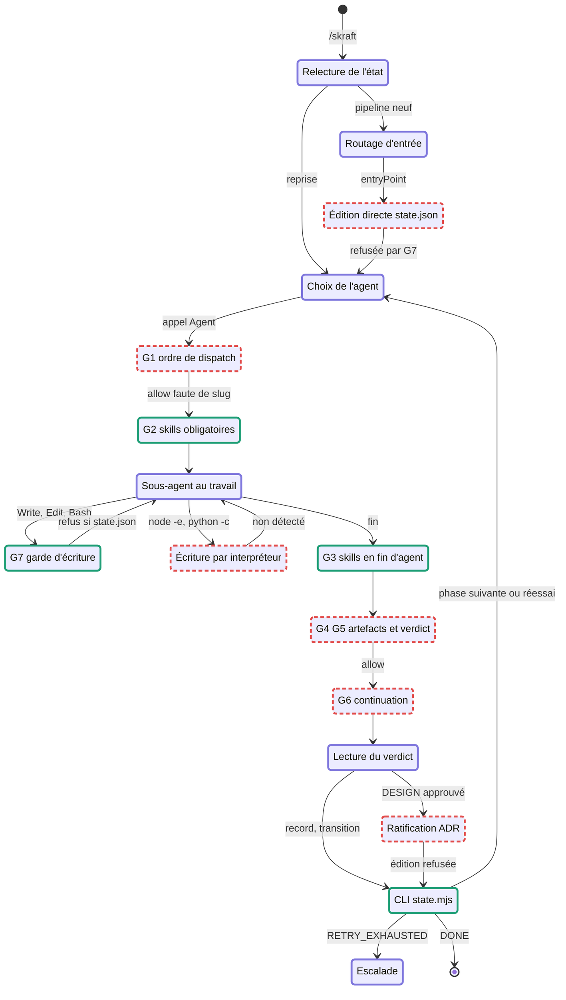
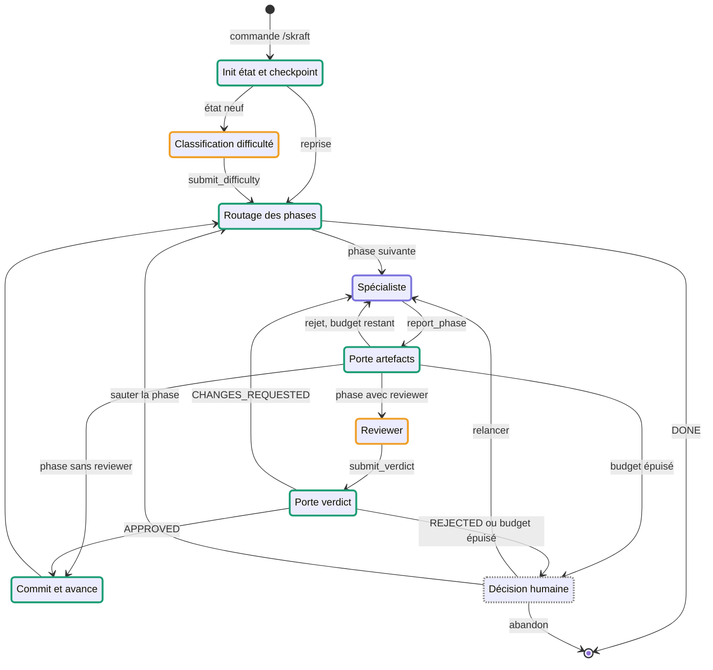
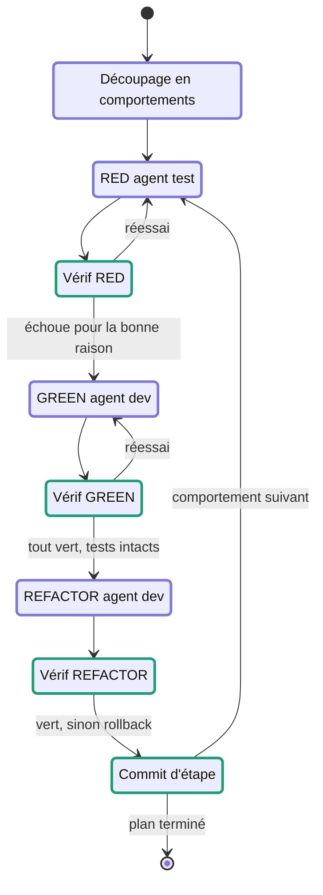

# skraft : diagrammes d'état comparés

22/09/2026 · Samir

Dans skraft-plugin, c'est le LLM orchestrateur qui décide chaque transition, encadré par des
garde-fous déclenchés par les hooks du harnais. Dans notre approche, un réducteur déterministe
décide les transitions et le LLM n'intervient que pour produire des artefacts et des verdicts,
toujours vérifiés par du code avant d'avancer.

> **Correction du 25/09/2026.** Ce document affirmait que les hooks de skraft « ne se déclenchent
> pas en conditions réelles ». C'était exact de la 1.5.2 analysée le 22 septembre ; **ce ne l'est
> plus** : sur la branche `refactor/v1.6.0-tracking-substrate`, la résolution du projet actif est
> corrigée et les garde-fous se déclenchent (document 02, « Suivi au 25 septembre »).
>
> La comparaison qui suit garde tout son sens, mais son objet change : elle n'oppose plus un
> mécanisme qui marche à un mécanisme en panne. Elle oppose **deux endroits où mettre la
> décision** — chez eux un LLM qui décide sous surveillance de garde-fous, chez nous un réducteur
> qui décide et un LLM qui propose. C'est une différence de conception, et c'est sur ce terrain
> qu'elle doit se défendre.

## Lecture du document

| Bordure | Signification |
| --- | --- |
| Violette | Décision ou production par un LLM |
| Verte | Code déterministe, vérifiable et testable |
| Rouge, pointillée | Contrôle prévu mais inopérant ou erroné en conditions réelles |
| Orange | Risque résiduel assumé : LLM dont la sortie est vérifiée mais reste un jugement |
| Grise, pointillée | Décision humaine |

Les références C1 à C7 renvoient aux constats de l'analyse technique de skraft-plugin (version 1.5.2).

### Mise à jour : branche 1.6.0

Ce document a été établi sur la version 1.5.2, puis mis à jour après la réanalyse de la branche `refactor/v1.6.0-tracking-substrate` (23 septembre 2026). La traduction entre hooks et harnais est corrigée : G2, G3 et G7 fonctionnent. L'état, l'ordre des phases et la résolution du projet ne le sont pas, et deux problèmes nouveaux apparaissent : le routage d'entrée et la ratification des ADR ne peuvent plus être enregistrés (N1), et G7 se contourne par un interpréteur (N2). Les niveaux de difficulté ont été supprimés : les quatre phases d'ingénierie s'exécutent toujours, RESEARCH compris. Un plan de refonte (`.specs/plan_todo.md`) prévoit un état unifié, une projection calculée de la prochaine action et des commandes typées ; il n'est pas encore implémenté.

Le diagramme et les tableaux de skraft ci-dessous décrivent la 1.6.0. Notre approche s'aligne sur elle : RESEARCH est toujours exécutée, et l'évaluation de difficulté ne sert plus qu'à régler les moyens (budget, granularité, lentilles).

### Hypothèses de départ

- Notre approche reprend les quatre phases de la configuration skraft : RESEARCH → DESIGN → DISTILL → DELIVER, avec RESEARCH sans reviewer.
- Elle tourne dans notre application, au-dessus du Copilot SDK : l'orchestrateur est du code, chaque agent tourne dans une session isolée.
- La phase DELIVER réutilise la machine à états TDD définie précédemment, imbriquée dans le pipeline.
- Les politiques pures de `domain/` de skraft sont reprises quand elles sont correctes ; le modèle d'état est unifié.

## skraft-plugin tel qu'il s'exécute (branche 1.6.0)

Contrôles effectifs en 1.6.0 : le CLI d'état, G2, G3 en fin d'agent et G7. Toujours muets : G1, G4, G5 et G6, faute de `projectSlug`. Les transitions sortant d'un état violet restent décidées par le LLM : l'ordre des agents, l'interprétation du verdict, le passage à la phase suivante.

Deux chemins sont désormais bloqués. L'enregistrement du routage d'entrée et la ratification des ADR passent par des éditions directes de `state.json`, que G7 refuse maintenant, et le CLI n'a aucune commande pour ces champs (N1). En 1.5.2, ces éditions passaient faute de surveillance des outils d'écriture. G7 reste par ailleurs contournable par un interpréteur (N2), et la clôture de RESEARCH échoue toujours, l'état étant initialisé en DISCOVER (C3).

### États de skraft-plugin

| État | Acteur | Entrées | Sorties | Fichiers | Faiblesse en 1.6.0 |
| --- | --- | --- | --- | --- | --- |
| Relecture de l'état | LLM | `state.mjs get --slug` | Liste de tâches native dans le contexte du LLM | `state.json` | L'état de travail vit dans le contexte, pas dans le fichier |
| Routage d'entrée | LLM + skill | Transfert amont éventuel, confirmé par l'utilisateur | `entryPoint` : DISCOVER sauté ou non | `state.json` | Écrit à chaque pipeline neuf par édition directe, désormais refusée (N1) |
| Choix de l'agent | LLM | Tâches, champs de l'état | Appel de l'outil Agent avec en-tête de dispatch | — | Ordre des phases garanti par le prompt seul |
| G1 ordre de dispatch | Hook | `tool_input.subagent_type` | Aucune sortie : autorisation | `skraft-framework.config.json` | Muet faute de `projectSlug` (C1) ; bloquerait tout sinon (C2) |
| G2 skills obligatoires | Hook | Nom de l'agent | `additionalContext` au format du harnais | `agentSkills`, `SKILL.md` | Corrigé (C5) |
| Sous-agent au travail | LLM | Prompt, skills, artefacts amont | Fichiers dans le dossier de suivi et le dépôt | Dossier de suivi, dépôt | Aucun périmètre effectif sur `src/` et `tests/` : G8 en fail-open |
| G7 garde d'écriture | Hook | Write, Edit, Bash | Refus au format du harnais | — | Corrigé (C4, C5) ; contournable par `node -e` ou `python3 -c` (N2) |
| G3 skills en fin d'agent | Hook | Transcript du sous-agent | Blocage si une skill obligatoire n'a pas été lue | `logs/skill-audit.jsonl` | Corrigé dans le code (C7), non testé de bout en bout |
| G4 G5 artefacts et verdict | Hook | Payload sans `projectSlug` | Aucune sortie | — | Muets (C1) ; vocabulaire des verdicts divergent (C6) |
| G6 continuation | Hook | Payload | Aucune sortie | — | Muet (C1) |
| Lecture du verdict | LLM | Rapport de revue | Traduction `NEEDS_REWORK` → `CHANGES_REQUESTED`, `record-verdict`, `incr-retry` | `state.json` | Traduction laissée au LLM (C6) |
| Ratification ADR | LLM + humain | ADR en statut `Proposed` | `adrRatification` par édition directe | `state.json` | Édition refusée par G7, aucune commande CLI : ratification non enregistrable (N1) |
| CLI state.mjs | Code | Commandes shell | `state.json` atomique, sauvegardes | `state.json` | Toujours initialisé en DISCOVER, cycle à cinq phases (C3) |
| Escalade | LLM | `RETRY_EXHAUSTED` | Message à l'utilisateur | — | Dépend de l'arrêt effectif du LLM |

## Notre approche

### Pipeline

Toutes les transitions partent d'un état vert ou gris : le LLM ne choisit jamais la suite. Il produit un artefact ou un verdict, que le code valide avant de décider. Le spécialiste de DELIVER est remplacé par la sous-machine TDD ci-dessous.

### Sous-machine DELIVER

La sortie de la sous-machine alimente la Porte artefacts du pipeline, puis le reviewer DELIVER. Les escalades internes (trois échecs sur une vérification) remontent à la Décision humaine du pipeline.

### États de notre approche

| État | Acteur | Entrées | Sorties | Fichiers | Risque résiduel |
| --- | --- | --- | --- | --- | --- |
| Init état et checkpoint | Code | Commande, slug, story | État initial sur la première phase de `phaseOrder`, SHA Git de départ | `.skraft/{slug}/state.json`, configuration | Aucun |
| Classification difficulté | LLM | Story, grille de difficulté | Outil `submit_difficulty` avec un niveau parmi quatre | État | Jugement subjectif ; confirmable par l'utilisateur en mode simple |
| Routage des phases | Code | État, `phaseOrder`, difficulté | Phase suivante, ou DONE ; `skipPhases` calculé par règle | État | Aucun |
| Spécialiste | LLM | Dossier de passation, skills injectées, artefacts amont | Fichiers dans son périmètre, outil `report_phase` | Dossier de suivi | Qualité du contenu, jugée ensuite par le reviewer |
| Porte artefacts | Code | Rapport du spécialiste, état du disque | Accepté, ou rejet motivé avec retour au spécialiste | Motifs d'artefacts attendus, empreintes | Vérifie la forme et le périmètre, pas le fond |
| Reviewer | LLM | Artefacts, critères de revue, lentilles | Rapport écrit, outil `submit_verdict` avec verdict et constats | `reviews/…/*.md` | Le verdict reste un jugement de LLM |
| Porte verdict | Code | Verdict structuré, rapport écrit | Transition APPROVED, relance ou escalade ; compteur de réessais | État | Aucun |
| Commit et avance | Code | Phase validée | Commit Git, nouvelle phase dans l'état, bilan intermédiaire | Dépôt Git, état | Aucun |
| Décision humaine | Humain | Motif d'escalade, historique | Relancer, sauter la phase, abandonner | État, journal | Dépend de la disponibilité de l'utilisateur |
| RED, GREEN, REFACTOR | LLM | Comportement ciblé, retour du vérificateur | Test ou code dans le périmètre de la session | `tests/`, `src/` | Qualité du test ou du code |
| Vérif RED, GREEN, REFACTOR | Code | Résultats du lanceur de tests, diff Git, empreinte des tests | Commit ou rollback, réessai ou escalade | Rapport JSON du lanceur | Dépend de l'analyse correcte de la sortie du lanceur par stack |

Les risques résiduels se concentrent sur trois jugements de LLM : la difficulté, le contenu produit, et le verdict du reviewer. Ils sont encadrés par des sorties structurées et des vérifications de forme, mais un reviewer complaisant peut toujours valider un artefact médiocre.

## Comparaison

| Dimension | skraft-plugin | Notre approche |
| --- | --- | --- |
| Qui choisit l'étape suivante | LLM orchestrateur, guidé par son prompt | Réducteur `transition(state, event)` |
| Nature du contrôle | Négatif : les hooks peuvent refuser, pas ordonner | Positif : le code lance chaque agent et chaque vérification |
| Déclenchement des vérifications | Hooks du harnais, conditionnés au payload | Effets `verify*` exécutés à chaque transition |
| Identification du projet et de l'agent | Attendue dans le payload, absente en pratique | Connue de l'orchestrateur, qui a créé la session |
| Sortie des agents | Fichiers markdown, verdict extrait par regex | Outils terminaux avec schéma (`report_phase`, `submit_verdict`) |
| Écriture de l'état | CLI, plus deux champs modifiés à la main | Seul le runner écrit ; aucune édition par un agent |
| Protection des fichiers | Regex sur les commandes Bash | Périmètre par session, hook sur tous les outils d'écriture, empreinte des tests |
| Réessais et escalade | Le LLM compare les compteurs et décide de s'arrêter | Budget appliqué par le réducteur, escalade vers l'utilisateur |
| Skills | Injection par hook, lecture vérifiée par transcript | Injectées dans la configuration de session, par construction |
| Contexte des agents | Sous-agents lancés par le LLM parent | Session neuve par phase, dossier de passation explicite |
| Portabilité | Claude Code, Copilot CLI, Cursor via manifestes | Liée à notre application et au Copilot SDK |
| Coût | Faible : hooks légers, une session orchestratrice | Plus élevé : une session par phase et par réessai |
| Testabilité | Services testés hors harnais ; contrat harnais non testé | Réducteur pur testable sans LLM ni disque ; contrat SDK typé |

Le compromis principal est la portabilité contre la garantie. skraft s'installe dans trois harnais mais n'y contrôle presque rien ; notre approche garantit le déroulé mais n'existe que dans notre application.

## Faiblesses et erreurs

### Dans skraft-plugin, et leur traitement

| Réf. | Faiblesse | Statut en 1.6.0 | Traitement dans notre approche |
| --- | --- | --- | --- |
| C1 | Gardes conditionnés à un `projectSlug` absent des payloads | Non corrigé, absent du plan de refonte | Le slug et l'agent sont connus du code qui a créé la session |
| C2 | Deux modèles d'état incompatibles | Non corrigé, prévu par le plan | Un seul état, lu et écrit par le réducteur |
| C3 | Initialisation en DISCOVER, cycle à cinq phases | Non corrigé, prévu par le plan | `phaseOrder` unique lu depuis la configuration |
| C4 | `Write`/`Edit` non surveillés, noms d'outils Copilot non reconnus | Corrigé ; contournement par interpréteur (N2) | Garde sur tous les outils d'écriture, et détection par diff et empreinte à chaque porte |
| C5 | Format de sortie des hooks non reconnu | Corrigé | Hooks du SDK typés, exécutés dans notre processus |
| C6 | Vocabulaire des verdicts divergent | Non corrigé | Enum unique imposé par le schéma de `submit_verdict` |
| C7 | Transcript et chemin de lecture mal lus | Corrigé dans le code | Skills injectées dans la session |
| E1 | « Commit vérifié » réduit à un arbre Git propre | Non corrigé | Commit fait par le code, depuis le SHA de départ enregistré |
| E2 | L'ordre des phases ne dépend que du prompt | Inchangé : le plan garde un orchestrateur LLM, guidé par une projection calculée | Ordre imposé et exécuté par le réducteur |
| E3 | L'arrêt au budget épuisé dépend du LLM | Inchangé | Budget appliqué par le code, escalade vers l'utilisateur |
| N1 | Routage d'entrée et ratification des ADR non enregistrables | Nouveau ; commandes typées prévues par le plan | État Ratification bloquant, décision persistée par le code |
| N2 | G7 contournable par `node -e` ou `python3 -c` | Nouveau, absent du plan | Aucun agent n'écrit l'état ; seul le runner écrit, et l'intégrité est vérifiée |

### Dans notre approche

| Réf. | État concerné | Risque | Atténuation |
| --- | --- | --- | --- |
| R1 | Reviewer | Verdict complaisant ou incohérent avec les constats | Lentilles indépendantes en sessions séparées, verdict pondéré par le code ; constats obligatoires dans le schéma |
| R2 | Classification difficulté | Mauvais routage : RESEARCH sauté à tort | Proposition du LLM, confirmation par l'utilisateur ; RESEARCH jamais sauté pour les deux niveaux supérieurs |
| R3 | Vérif RED, GREEN, REFACTOR | Sortie du lanceur de tests mal interprétée | Formats standards (JUnit XML, rapport Stryker) décrits dans le profil de stack, vérifié par `/stack doctor` avec des tests canaris |
| R4 | Porte artefacts | Artefact présent mais vide ou hors sujet | Contrôles de structure minimale par type d'artefact ; le fond reste l'affaire du reviewer |
| R5 | Ensemble | Coût en requêtes des sessions multiples | Estimation avant lancement, plafond par tâche, reprise plutôt que relance complète |
| R6 | Ensemble | Perte de portabilité hors de notre application | Garder les politiques pures en bibliothèque réutilisable, adaptables en hooks pour les harnais |

## Fichiers de contrôle

| Rôle | skraft-plugin 1.6.0 | Notre approche |
| --- | --- | --- |
| Câblage des contrôles | Deux manifestes `hooks.json` identiques (Claude Code, Copilot) ; trois en 1.5.2 | Aucun : hooks enregistrés par code à la création de chaque session |
| Définition du pipeline | `skraft-framework.config.json` généré, plus une liste de phases codée en dur dans la machine à états | Manifeste d'extension : `phaseOrder`, agents par phase, skills, artefacts attendus — source unique |
| Réglages du projet | `skraft-config.json` à la racine | `ctx.settings` de l'extension |
| État du pipeline | `.copilot-tracking/skraft-plans/{slug}/state.json`, écrit par le CLI ; certains champs prévus en édition directe, désormais refusée | État persisté par le moteur de tâches, écrit uniquement par le runner, avec sauvegardes |
| Journal | `logs/skill-audit.jsonl`, décisions des hooks | Bus d'événements de l'application : transitions, vérifications, appels d'outils, décisions de permission |
| Rapports de revue | `reviews/…/*.md`, verdict extrait par expression régulière | Même fichier pour l'humain, plus le verdict structuré de `submit_verdict` qui fait foi |
| Preuve de livraison | Arbre Git propre | Commits créés par le code à chaque transition, SHA enregistrés dans l'état |
| Configuration des agents | Une surface par client : 31 fichiers pour Copilot, leur équivalent pour Claude Code (22 agents en 1.5.2) | Rôles repris des mêmes fichiers, déclarés dans `contributes.agents` |

Les skills (38 en 1.6.0) et les prompts d'agents de skraft sont réutilisables quasiment tels quels : c'est la partie la plus riche du dépôt, et elle ne dépend pas du mécanisme de contrôle. L'adaptateur `harness-input.mjs` de la 1.6.0, qui normalise les noms d'outils des deux harnais, est aussi directement réutilisable.

## Questions ouvertes

Ces réponses changent le diagramme cible ; les hypothèses actuelles sont indiquées entre parenthèses.

- [ ] Granularité de la sous-machine DELIVER : un cycle TDD par scénario d'acceptation, ou par comportement découpé par un LLM ? (hypothèse : par comportement, à partir des scénarios de DISTILL)
- [ ] Reviewers : garder les quatre lentilles de skraft en sessions parallèles avec un verdict pondéré par le code, ou un reviewer unique par phase ? (hypothèse : lentilles, pour réduire R1)
- [ ] Difficulté : décision du LLM seule, ou confirmation systématique par l'utilisateur ? (hypothèse : confirmation en mode simple, automatique en mode avancé)
- [ ] Portabilité : faut-il garder une variante par hooks pour Claude Code et Copilot CLI, en réutilisant les politiques pures ? (hypothèse : non dans un premier temps)
- [ ] Phases produit : intégrer Backlog Discoverer et Backlog Planner au pipeline, ou les garder comme agents autonomes comme dans skraft ? (hypothèse : autonomes)
- [ ] Licence : skraft est en GPL-3.0-or-later ; reprendre ses politiques et ses prompts impose-t-il cette licence à l'extension, et est-ce acceptable ?
