# skraft pas à pas : fragilités et améliorations

22/09/2026 · Samir

Ce document suit une même story à travers chaque étape du pipeline skraft, et montre pour chacune ce que fait skraft-plugin aujourd'hui, où il est fragile, et ce que notre approche change. La règle qui guide toutes les améliorations : le LLM produit, le code vérifie et décide de la suite.

## Comment lire ce document

### Légende des organigrammes

| Symbole | Bordure | Signification |
| --- | --- | --- |
| 🤖 | Violette | Travail ou décision d'un LLM |
| ⚙️ | Verte | Code déterministe |
| ⚠️ | Rouge, pointillée | Contrôle prévu mais inopérant, ou fragilité avérée |
| 🔶 | Orange | Jugement de LLM encadré : sortie structurée, vérifiée par le code |
| 👤 | Grise, pointillée | Décision humaine |
| 🪝 | Selon son efficacité réelle | Point où le harnais déclenche un hook de contrôle de skraft |

Chaque organigramme place côte à côte skraft-plugin (à gauche) et notre approche (à droite). Les références C1 à C7 renvoient aux constats de l'analyse technique de skraft-plugin 1.5.2.

### Exemple fil rouge

Toutes les étapes déroulent la même story, dans une application de gestion d'insulinothérapie écrite en Swift :

> **US-12 — Plafonner le bolus proposé.** En tant que patient, quand le calcul propose une dose de bolus supérieure au plafond défini par mon médecin, je veux que la dose proposée soit limitée à ce plafond et qu'une alerte m'explique pourquoi.

Critères d'acceptation en brouillon :

1. Plafond de 10 U, calcul à 6 U : dose proposée 6 U, pas d'alerte.
2. Plafond de 10 U, calcul à 12,5 U : dose proposée 10 U, alerte « Dose plafonnée à 10 U ».
3. Aucun plafond configuré : dose proposée égale au calcul, pas d'alerte.

Question ouverte laissée dans la story : le plafond s'applique-t-il par prise ou par jour ?

Cet exemple est choisi parce qu'il combine un invariant métier critique, un projet non .NET, et une ambiguïté à résoudre : trois situations où les fragilités de skraft deviennent visibles.

## Vue d'ensemble du pipeline

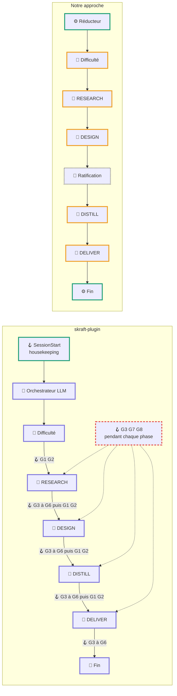

Les deux pipelines ont les mêmes phases. La différence est dans ce qui les relie.

- **skraft-plugin** : l'orchestrateur LLM enchaîne les phases selon son prompt. Les hooks sont censés le surveiller, mais en conditions réelles ils laissent tout passer (C1, C4, C5). Chaque phase est entièrement confiée à un agent, qui produit son travail et, souvent, sa propre preuve.
- **Notre approche** : un réducteur déterministe enchaîne les phases. Chaque phase est découpée en un travail de LLM encadré, suivi de portes vérifiées par le code. La ratification des ADR devient un état à part entière, bloquant.

### Position des hooks de contrôle dans skraft

À chaque phase, l'orchestrateur lance un sous-agent avec l'outil Agent. Le harnais déclenche alors les hooks à six moments précis de ce cycle, toujours les mêmes quelle que soit la phase.

#### Les gardes G1 à G8

Un hook est une commande que le harnais (Claude Code ou Copilot) exécute automatiquement quand un événement se produit : avant ou après l'utilisation d'un outil, au démarrage ou à la fin d'un sous-agent. skraft déclare pour chaque événement la commande `node hook.mjs <événement> <outil>`. Le harnais lui transmet sur l'entrée standard un JSON décrivant l'événement (outil appelé, arguments, agent concerné), et le hook répond par une décision : laisser passer, refuser, bloquer, ou ajouter du contexte. Les huit gardes sont les contrôles appliqués derrière ces hooks.

**G1 — Ordre de dispatch.** Événement intercepté : `PreToolUse` sur l'outil Agent, juste avant que l'orchestrateur lance un sous-agent. Contrôle : le hook lit `state.json` et calcule, avec `pipeline-policy.mjs`, l'agent qui devrait être lancé à ce stade, d'après la phase courante, ce qui a déjà été produit, le dernier verdict et le nombre de réessais. Si l'agent demandé n'est pas celui attendu, par exemple le Software Engineer alors que DESIGN n'est pas approuvé, le lancement est bloqué. Mode fail-closed : un état illisible bloque aussi.

**G2 — Skills obligatoires.** Événement intercepté : `SubagentStart`, au moment où le sous-agent démarre. Contrôle : le hook cherche dans `skraft-framework.config.json` la liste des skills obligatoires de cet agent (par exemple `outside-in-tdd` et `mutation-testing` pour le Software Engineer) et l'ajoute au contexte du sous-agent, pour qu'il les lise avant de travailler. Ce n'est pas un blocage mais une injection. Mode fail-open.

**G3 — Lecture des skills vérifiée.** Deux événements interceptés. Pendant le travail, `PostToolUse` sur l'outil Read : chaque lecture d'un fichier `SKILL.md` est inscrite dans `logs/skill-audit.jsonl`. À la fin, `SubagentStop` : le hook compare les skills obligatoires avec celles réellement lues dans la transcription du sous-agent, et bloque s'il en manque une. Mode fail-open.

**G4 — Artefacts attendus.** Événement intercepté : `SubagentStop`, quand le sous-agent termine. Contrôle : `artifact-policy.mjs` récupère les motifs d'artefacts attendus pour cet agent (par exemple `details/{date}/event-model-*.md` pour l'architecte) et vérifie que des chemins correspondants ont été enregistrés dans `state.json`. Il ne vérifie pas que les fichiers existent sur le disque. Mode fail-closed.

**G5 — Verdict et commit.** Événement intercepté : `SubagentStop`, à la fin d'un reviewer ou de l'agent DELIVER. Contrôle : pour un reviewer, le hook lit son rapport, extrait la ligne `**Verdict:**` et vérifie qu'elle correspond au verdict enregistré dans l'état. Pour DELIVER, il vérifie que l'arbre Git est propre, ce que skraft appelle « commit vérifié ». Mode fail-closed.

**G6 — Continuation.** Événement intercepté : `PostToolUse` sur l'outil Agent, quand le sous-agent a rendu la main à l'orchestrateur. Contrôle : le hook recalcule l'étape suivante (lancer le reviewer, relancer le spécialiste, passer à la phase suivante ou escalader) et l'injecte dans le contexte de l'orchestrateur, pour le guider. Mode fail-open.

**G7 — Protection de l'état.** Événement intercepté : `PreToolUse` sur l'outil Bash, avant l'exécution d'une commande shell. Contrôle : `session-guard-policy.mjs` refuse toute commande qui écrit dans `state.json` ou dans le journal d'exécution, pour que l'état ne soit modifié que par le CLI `state.mjs`. Il est conçu pour couvrir aussi les outils d'écriture de fichiers, mais ceux-ci ne sont pas routés vers le hook. Mode fail-closed.

**G8 — Périmètre de DELIVER.** Événement intercepté : `PreToolUse`, avant une écriture de fichier. Contrôle : quand la phase courante est DELIVER, seul l'agent DELIVER surveillé peut écrire dans `src/` ou `tests/` ; tout autre agent est refusé. Mode fail-open si l'état ne peut pas être lu.

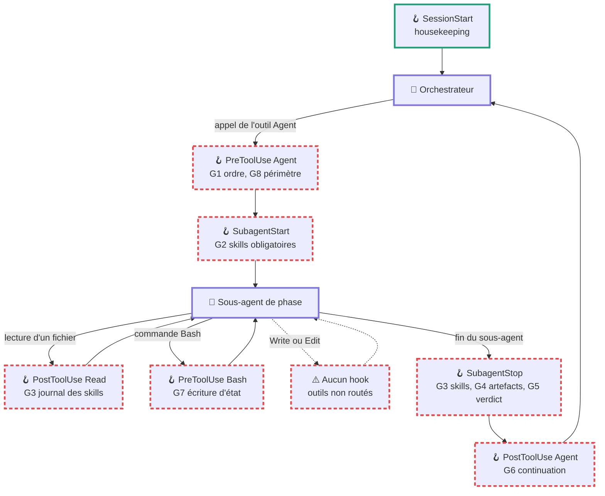

| Moment | Événement du harnais | Gardes | Ce qu'il devrait faire | Ce qui se passe réellement |
| --- | --- | --- | --- | --- |
| Ouverture de session | `SessionStart` | Housekeeping | Purger le journal d'audit et les sauvegardes expirées | Fonctionne |
| Avant le lancement d'un sous-agent | `PreToolUse`, outil Agent | G1, G8 | Refuser un agent lancé hors séquence | Ignoré faute de `projectSlug` (C1) ; bloquerait tout sinon (C2) |
| Au démarrage du sous-agent | `SubagentStart` | G2 | Injecter la liste des skills obligatoires | Format de sortie probablement non reconnu (C5) |
| À chaque lecture de fichier | `PostToolUse`, outil Read | G3 | Journaliser les lectures de `SKILL.md` | Lit `path` alors que Claude Code envoie `file_path` (C7) |
| À chaque commande shell | `PreToolUse`, outil Bash | G7 | Refuser une écriture directe dans `state.json` | Refus émis dans un format probablement ignoré (C5) ; noms d'outils Copilot non reconnus (C4) |
| À chaque écriture par l'outil d'édition | Aucun | Aucun | Protéger `state.json`, `src/` et `tests/` | Rien n'est routé : écritures libres (C4) |
| À la fin du sous-agent | `SubagentStop` | G3, G4, G5 | Bloquer si skill non lue, artefact absent ou verdict incohérent | Contrôle des skills en fail-open (C7) ; G4 et G5 ignorés (C1) |
| Au retour vers l'orchestrateur | `PostToolUse`, outil Agent | G6 | Indiquer l'agent suivant, une relance ou une escalade | Ignoré (C1) |

Seul `SessionStart` remplit son rôle aujourd'hui. Les six autres points d'accroche sont bien placés : c'est leur exécution qui fait défaut, pas leur conception.

### Structure commune d'une phase

Dans notre approche, chaque phase suit le même gabarit, qui sera détaillé étape par étape.

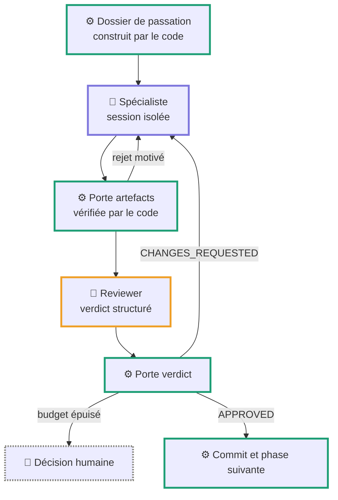

## Étape 0 — Démarrage et reprise

**Rôle** : créer l'état d'un nouveau pipeline, ou reprendre un pipeline interrompu au bon endroit.

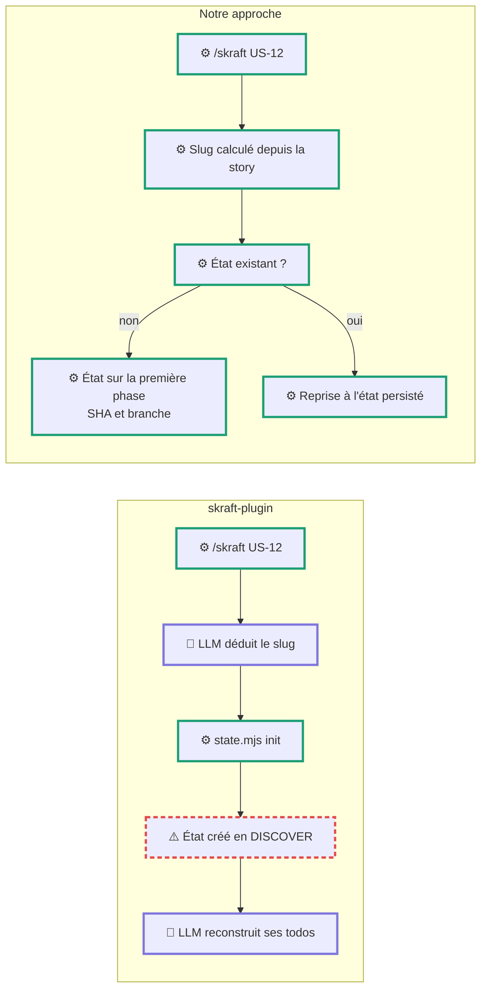

### Exemple déroulé

**skraft-plugin.** L'utilisateur tape `/skraft US-12`. L'orchestrateur choisit lui-même un slug, par exemple `plafond-bolus`, puis lance `state.mjs init --slug plafond-bolus`. Le CLI crée `state.json` avec `currentPhase: "DISCOVER"`, une phase qui n'existe plus dans le pipeline (C3). L'orchestrateur relit l'état, reconstruit une liste de tâches dans son contexte, et annonce qu'il commence par RESEARCH. Le lendemain, l'utilisateur relance `/skraft` : le LLM peut choisir un autre slug (`us-12-bolus-cap`) et créer un second état, sans lien avec le premier.

**Notre approche.** Le slug est dérivé de l'identifiant de la story (`us-12`), toujours le même. Le code crée l'état sur la première phase de la configuration (`RESEARCH`), enregistre le SHA Git de départ (`a1b2c3d`) et crée la branche `skraft/us-12`. Le lendemain, la même commande retrouve l'état et reprend exactement là où la tâche s'était arrêtée, par exemple au milieu d'un réessai de DESIGN.

### Fragilités de skraft

- Initialisation sur une phase inexistante (C3) : toute la suite démarre sur une incohérence.
- Slug choisi par le LLM : deux lancements peuvent créer deux états pour la même story.
- Pas de point de retour Git enregistré : impossible d'annuler proprement tout le pipeline.
- L'état de travail réel (les todos) vit dans le contexte du LLM, pas dans le fichier.

### Améliorations

| Fragilité | Amélioration | Type |
| --- | --- | --- |
| Phase initiale incohérente | État initialisé sur `phaseOrder[0]`, lu depuis la configuration unique | Code |
| Slug non déterministe | Slug dérivé de l'identifiant de la story | Code |
| Pas de retour arrière global | SHA de départ et branche dédiée enregistrés dans l'état | Code |
| État de travail dans le contexte | Tout l'état dans le moteur de tâches, rien à reconstruire | Code |

## Étape 1 — Classification de la difficulté

**Rôle** : estimer la complexité de la story, ce qui décide si RESEARCH est exécutée et comment DELIVER s'organise. Quatre niveaux : `simple`, `medium`, `medium-hard`, `challenging`. Le niveau est écrit une seule fois.

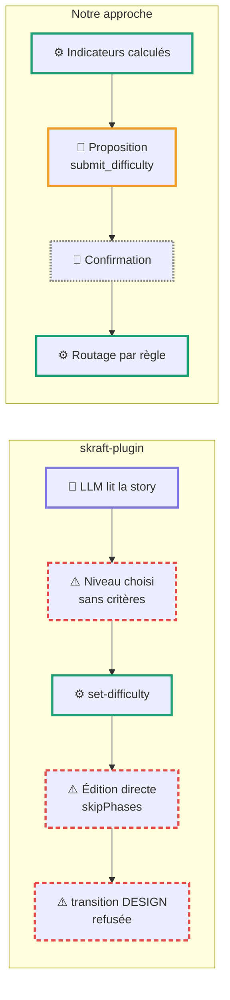

### Exemple déroulé

**skraft-plugin.** L'orchestrateur lit US-12 : trois critères, une règle simple de plafonnement. Il classe la story `medium`. Ce niveau entraîne le saut de RESEARCH : l'orchestrateur écrit lui-même `entryPoint.skipPhases: ["RESEARCH"]` dans `state.json`, puis appelle `state.mjs transition --to DESIGN`. La machine à états, restée sur DISCOVER, refuse avec `ILLEGAL_PHASE_SKIP` ou `PHASE_MISMATCH`. Le LLM improvise alors : nouvelle tentative, modification manuelle de `currentPhase`, ou poursuite sans enregistrer la transition. La question ouverte « par prise ou par jour ? » est ignorée : rien dans la skill de difficulté ne la prend en compte.

**Notre approche.** Le code calcule des indicateurs à partir de la story :

| Indicateur | Valeur pour US-12 | Source |
| --- | --- | --- |
| Critères d'acceptation | 3 | Comptage dans la story |
| Modules cités | 2 (calcul de bolus, réglages médecin) | Correspondance avec l'arborescence du dépôt |
| Nouvelle intégration externe | Non | Mots-clés et fichiers cités |
| Questions ouvertes | 1 | Section dédiée de la story |

Une grille déterministe propose `medium`, mais une question ouverte sur une règle métier relève le niveau à `medium-hard`. Le LLM reçoit les indicateurs et rend une proposition structurée avec une justification courte. L'utilisateur confirme `medium-hard`, et le routage exécute donc RESEARCH, par règle et sans modification manuelle de l'état.

### Fragilités de skraft

- Aucun critère défini dans la skill : le niveau est un jugement libre, irréversible.
- La skill décrit encore le pipeline à cinq phases (saut de DISCOVER), l'orchestrateur l'utilise pour sauter RESEARCH.
- Le saut de phase passe par une édition directe de l'état, qui contourne le CLI (C4), puis échoue sur la machine à états (C3).
- Les incertitudes de la story ne pèsent pas dans la décision.

### Améliorations

| Fragilité | Amélioration | Type |
| --- | --- | --- |
| Jugement sans critères | Indicateurs calculés, grille explicite, LLM seulement pour les cas limites | Code, puis LLM encadré |
| Décision irréversible non validée | Confirmation par l'utilisateur, en mode simple | Humain |
| Saut de phase par édition manuelle | `skipPhases` dérivé du niveau par une règle du réducteur | Code |
| Questions ouvertes ignorées | Toute question ouverte sur une règle métier relève le niveau d'un cran | Code |

## Étape 2 — RESEARCH

**Rôle** : enquêter sur le code existant et les sources externes, et produire un document de recherche sourcé qui recommande une approche à l'architecte. Aucun code, aucune décision. C'est la seule phase sans reviewer.

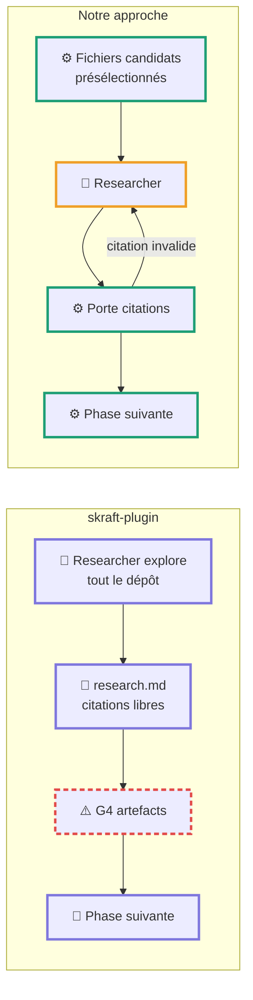

### Exemple déroulé

**skraft-plugin.** Le researcher explore le dépôt Swift, trouve `BolusCalculator.swift` et `DoctorSettings.swift`, consulte la documentation de santé publique sur les plafonds d'insuline, et rédige `research/2026-09-22/us-12-research.md`. Il écrit par exemple : « le calcul est centralisé dans `Sources/Bolus/BolusCalculator.swift:40-72` ». Or le fichier ne fait que 55 lignes : la plage est inventée. Il recommande « appliquer le plafond dans le calculateur » et laisse ouverte la question « par prise ou par jour ». Aucun reviewer, et G4 ne s'exécute pas faute de `projectSlug` (C1) : le document passe tel quel.

**Notre approche.** Avant de lancer l'agent, le code présélectionne les fichiers candidats par recherche de mots-clés de la story (`bolus`, `plafond`, `max`, `dose`) et les place dans le dossier de passation : l'agent commence son enquête au bon endroit. À la fin, la porte citations analyse le document :

| Contrôle | Résultat pour US-12 |
| --- | --- |
| Sections du gabarit présentes | 7 sur 7 |
| Chemins cités existants | 4 sur 4 |
| Plages de lignes dans les limites du fichier | 3 sur 4 : `BolusCalculator.swift:40-72` dépasse la longueur réelle (55 lignes) |
| URL bien formées | 2 sur 2 |
| Recommandation unique présente | Oui |
| Questions ouvertes reportées | 1 : « par prise ou par jour » |

Le document est rejeté avec un retour précis : « la citation `BolusCalculator.swift:40-72` dépasse la fin du fichier, qui fait 55 lignes ». L'agent corrige en `:18-49`. La question ouverte, détectée par le code, est posée à l'utilisateur dès maintenant plutôt que découverte en DELIVER. Réponse : « par prise ».

### Fragilités de skraft

- Pas de reviewer : la règle « chaque affirmation est sourcée » n'est vérifiée par personne.
- Citations de lignes invraisemblables non détectées, le défaut le plus courant d'un LLM sur cette tâche.
- Exploration de tout le dépôt par l'agent : coûteuse en tokens, et parfois hors sujet.
- Les questions ouvertes restent dans le document jusqu'à ce qu'un agent aval bute dessus.

### Améliorations

| Fragilité | Amélioration | Type |
| --- | --- | --- |
| Citations non vérifiées | Porte citations : chemins, plages de lignes, URL | Code |
| Structure non contrôlée | Présence des sections du gabarit | Code |
| Exploration coûteuse | Présélection des fichiers candidats dans le dossier de passation | Code |
| Questions ouvertes tardives | Extraction et question à l'utilisateur en fin de phase | Code, puis humain |

La porte citations ne dit pas si la recherche est juste : elle garantit qu'elle est vérifiable. C'est suffisant pour se passer d'un reviewer LLM sur cette phase.

## Étape 3 — DESIGN et ratification des ADR

**Rôle** : transformer la story en décisions d'architecture formelles : modèle d'événements, découpage DDD, ADR, contrats d'interface. Chaque ADR naît en statut `Proposed` et doit être ratifié par un humain.

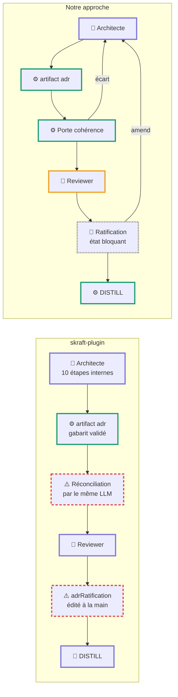

### Exemple déroulé

**skraft-plugin.** L'architecte reçoit la story et la recherche. Il cherche les artefacts de DISCUSS exigés par son prompt, phase qui n'existe plus : selon les cas, il s'arrête sur un blocker ou continue avec ce qu'il trouve. Il produit un modèle d'événements (commande `ComputeBolus`, événement `BolusCapped`), un value object `MaxBolus`, et l'`ADR-008 — Plafond appliqué dans le domaine`, rendu par la commande `artifact adr` qui valide les champs obligatoires. Dans ses contrats, il nomme l'événement `BolusLimited`, incohérent avec le modèle d'événements. Sa propre étape de réconciliation ne le voit pas. Le reviewer relit et approuve. L'orchestrateur écrit alors `adrRatification` dans `state.json` et peut enchaîner sur DISTILL sans attendre la réponse humaine : rien ne l'en empêche.

**Notre approche.** Même travail de l'architecte, même commande `artifact adr`. Puis la porte cohérence, exécutée par le code, compare les artefacts :

| Contrôle | Résultat pour US-12 |
| --- | --- |
| En-tête YAML valide sur chaque nouvel ADR | Oui, ADR-008 |
| Chaque événement des contrats existe dans le modèle d'événements | Non : `BolusLimited` absent, `BolusCapped` attendu |
| Chaque agrégat des diagrammes existe dans le modèle | Oui |
| Chaque remplacement d'ADR figure dans le nouvel ADR et dans le registre | Aucun remplacement |
| Numérotation des ADR continue et unique | Oui |

Rejet précis : « `BolusLimited` cité dans `contracts-us-12.md` n'existe pas dans `event-model-us-12.md` ». L'architecte corrige. Après approbation du reviewer, la machine entre dans l'état Ratification : l'utilisateur voit l'ADR-008 résumé en une phrase, et choisit accepter, refuser ou amender. La tâche reste suspendue, même si l'application est fermée, jusqu'à sa décision.

### Fragilités de skraft

- Entrées exigées d'une phase supprimée (DISCUSS), comportement de l'agent imprévisible.
- Réconciliation faite par le LLM qui a écrit les artefacts : il valide sa propre cohérence.
- Ratification humaine déclarée obligatoire, mais suivie par une édition manuelle de l'état et rien ne bloque l'avancée.
- Prompt de 484 lignes, plus deux skills chargées au démarrage : un coût de contexte élevé à chaque lancement.

### Améliorations

| Fragilité | Amélioration | Type |
| --- | --- | --- |
| Entrées manquantes | Dossier de passation construit par le code à partir des phases réellement exécutées | Code |
| Auto-réconciliation | Porte cohérence : noms d'événements, agrégats, en-têtes, registre de remplacements | Code |
| Ratification contournable | État Ratification bloquant, persisté, avec décision par ADR | Code, puis humain |
| Prompt surdimensionné | Découpage en deux sessions : modélisation, puis rédaction des ADR et contrats | LLM encadré |

Ce qui reste un jugement : la pertinence du découpage DDD et des décisions. C'est le rôle du reviewer et de l'humain qui ratifie.

## Étape 4 — DISTILL

**Rôle** : transformer les critères d'acceptation en scénarios Gherkin, rédiger le plan de test et le plan d'implémentation, puis écrire le test d'acceptance extérieur, qui doit échouer sur une assertion métier. C'est la boucle extérieure du double cycle TDD.

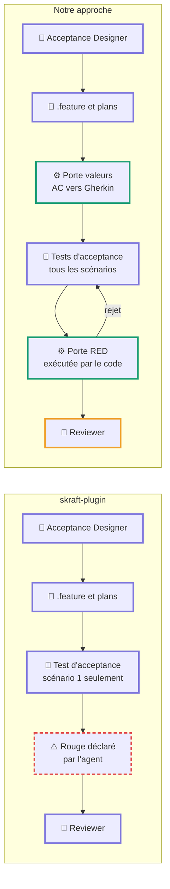

### Exemple déroulé

**skraft-plugin.** L'agent écrit `features/bolus-plafond.feature` avec trois scénarios, un plan de test, un plan d'implémentation, puis le test d'acceptance du premier scénario seulement. Deux problèmes passent inaperçus. D'abord, il écrit le scénario 2 avec « calcul à 12 U » au lieu de 12,5 U : la valeur a été arrondie, et c'est justement la valeur qui teste le plafonnement d'une dose fractionnaire. Ensuite, son test échoue parce que `BolusCapPolicy` n'existe pas encore : une erreur de compilation, pas une assertion métier. L'agent déclare pourtant « RED sur assertion métier ». Rien ne vérifie l'un ni l'autre. Autre détail : sa sortie déclarée est `tests/**/{Feature}AcceptanceTests.cs`, un nommage C#, dans un projet Swift.

**Notre approche.** Même travail de l'agent, mais deux portes s'ajoutent.

La porte valeurs compare les critères d'acceptation et les scénarios :

| Valeur des critères | Trouvée dans le `.feature` |
| --- | --- |
| 10 U, 6 U | Oui |
| 12,5 U | Non : « 12 U » trouvé à la place |
| « Dose plafonnée à 10 U » | Oui |

Rejet : « la valeur 12,5 du critère 2 n'apparaît pas dans le scénario 2 ». L'agent corrige.

L'agent écrit ensuite les tests d'acceptance des trois scénarios, dans `Tests/AcceptanceTests/BolusCapAcceptanceTests.swift`, le chemin étant fourni par l'adaptateur de stack Swift. La porte RED les exécute elle-même avec XCTest et lit le rapport :

| Test | Résultat | Verdict de la porte |
| --- | --- | --- |
| Scénario 1 | Erreur de compilation : `BolusCapPolicy` introuvable | Accepté : symbole manquant, attendu à ce stade |
| Scénario 2 | Assertion échouée : attendu 10, obtenu 12,5 | Accepté |
| Scénario 3 | Réussi | Rejeté : un test d'acceptance qui passe déjà ne prouve rien |

Le scénario 3 passe parce que le code actuel ne plafonne jamais : le comportement « aucun plafond » existe déjà. La porte le signale, et l'agent le marque comme test de non-régression plutôt que comme test moteur, ce que le reviewer vérifiera.

### Fragilités de skraft

- La copie « mot pour mot » des valeurs est une consigne de prompt : les arrondis et inventions passent.
- Le rouge « sur assertion métier » est déclaré par l'agent, jamais exécuté par un tiers.
- Seul le premier scénario reçoit son test d'acceptance en DISTILL : les suivants seront écrits en DELIVER par l'ingénieur qui fera passer le code.
- Nommage de sortie C# figé, dans un framework censé être multi-langage.
- Entrées exigées de la phase DISCUSS, supprimée.

### Améliorations

| Fragilité | Amélioration | Type |
| --- | --- | --- |
| Valeurs arrondies ou inventées | Porte valeurs : chaque littéral des critères doit apparaître dans le `.feature` et dans le test | Code |
| Rouge auto-déclaré | Porte RED : exécution par le code, classification de l'échec | Code |
| Tests d'acceptance écrits par l'ingénieur | Tous les tests d'acceptance écrits en DISTILL, gelés par empreinte | Code |
| Nommage propre à .NET | Chemins et commandes fournis par l'adaptateur de stack | Code |
| Test qui passe déjà | Détecté et requalifié en non-régression, visible du reviewer | Code, puis LLM encadré |

## Étape 5 — DELIVER

**Rôle** : faire passer les tests d'acceptance au vert par la boucle intérieure du TDD (tests unitaires, RED, GREEN, REFACTOR), avec des exigences élevées : mutation à 100 % sur le domaine et l'application, 90 % sur l'API et l'infrastructure, couverture de lignes à 100 %, et un fichier de preuves pour chaque cycle.

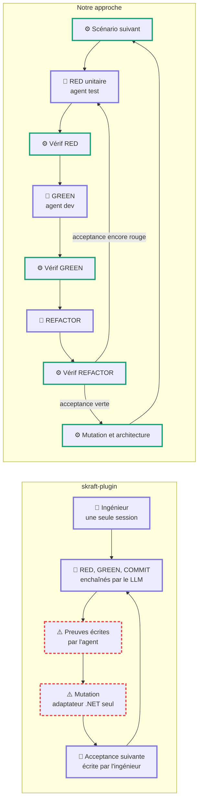

### Exemple déroulé

**skraft-plugin.** US-12 étant classée `medium-hard`, l'ingénieur lance un sous-agent par scénario ; en `medium`, il aurait tout fait lui-même en une seule session. Pour le scénario 2, il écrit un test unitaire `testCapsDoseAboveMax`, puis `BolusCapPolicy`, puis committe. Il lance lui-même les tests, recopie la sortie, calcule les empreintes sha256, et écrit `evidence/2026-09-22/qg-us-12.json`. Au premier essai, son test unitaire échouait sur une erreur de compilation ; il l'a corrigé, relancé, et a capturé la seconde exécution comme « RED observé ». Pour la mutation, la skill ne fournit qu'un adaptateur .NET : dans ce projet Swift, la porte ne peut pas tourner, et la règle dit qu'une porte qui ne tourne pas est un échec. L'agent le signale, ou contourne en déclarant la porte « non applicable ». Pour le scénario 3, c'est lui qui écrit le test d'acceptance, puis le code qui le fait passer. Enfin, une ligne de la skill l'autorise à supprimer un test qui ne tue aucun mutant.

**Notre approche.** Les tests d'acceptance des trois scénarios existent déjà, gelés par empreinte depuis DISTILL. Pour le scénario 2, la sous-machine déroule :

| Pas | Qui | Ce qui se passe pour US-12 |
| --- | --- | --- |
| RED unitaire | Agent test | Écrit `testCapsDoseAboveMax` dans `Tests/DomainTests/` |
| Vérif RED | Code | Lance XCTest : échec sur `XCTAssertEqual(10, 12.5)`. Capture sortie, code de sortie et empreinte dans le dossier de preuves. Commit `test:` |
| GREEN | Agent dev | Crée `BolusCapPolicy` et le branche dans `BolusCalculator` |
| Vérif GREEN | Code | Empreinte des tests inchangée ; au moins un fichier de `Sources/` modifié ; suite complète verte. Commit `feat:` |
| REFACTOR | Agent dev | Extrait le value object `MaxBolus` |
| Vérif REFACTOR | Code | Tout reste vert, tests inchangés. Commit `refactor:` |
| Acceptance | Code | Le test d'acceptance du scénario 2 est vert : scénario terminé |
| Mutation et architecture | Code | Muter sur le module Domain : 100 %. Analyse des imports : le module Domain n'importe que Foundation |

Si l'agent dev tente de faire passer le test en modifiant `testCapsDoseAboveMax`, la Vérif GREEN voit l'empreinte changer, annule et le relance avec le motif. Si un test ne tue aucun mutant, le code le signale au reviewer au lieu de laisser l'agent le supprimer.

### Fragilités de skraft

- Preuves auto-déclarées : l'agent exécute, capture, calcule les empreintes et écrit le fichier qu'un reviewer LLM lira ensuite.
- L'ingénieur écrit les tests d'acceptance des scénarios 2 et suivants : il écrit l'examen et la copie.
- « Ne jamais modifier un test rouge » est une consigne ; « supprimer un test qui ne tue aucun mutant » en est une autre qui la contredit en pratique.
- Un seul adaptateur de stack, pour .NET : en Swift ou TypeScript, les portes de qualité ne peuvent pas tourner.
- Toutes les étapes d'un cycle dans la même session : le passage de RED à GREEN n'est contrôlé par personne.
- Escalade prévue vers DISCUSS, phase supprimée, en cas de décision métier manquante.

### Améliorations

| Fragilité | Amélioration | Type |
| --- | --- | --- |
| Preuves auto-déclarées | Le code exécute les tests et la mutation, capture et écrit les preuves ; même schéma que skraft | Code |
| Examen et copie par le même agent | Tous les tests d'acceptance écrits en DISTILL ; agents test et dev séparés | Code |
| Intégrité par consigne | Empreinte de tous les tests à chaque Vérif ; suppression soumise à validation | Code, puis humain |
| Adaptateur .NET seul | Adaptateurs de stack en extension : XCTest et Muter, Vitest et Stryker, dotnet et Stryker.NET | Code |
| Transitions de cycle non contrôlées | Sous-machine RED, GREEN, REFACTOR avec Vérif entre chaque pas | Code |
| Fixture theater | Vérif GREEN exige au moins un fichier de production modifié | Code |
| Architecture jugée par un LLM | Règle de dépendance vérifiée par analyse des imports | Code |
| Escalade vers une phase fantôme | Suspension et question à l'utilisateur | Humain |

## Revue et verdict

**Rôle** : juger le travail d'une phase avant de l'accepter. Commun à DESIGN, DISTILL et DELIVER. C'est la partie la plus aboutie de skraft : le reviewer lance quatre lentilles indépendantes, chacune dans un contexte neuf, et synthétise un verdict pondéré. La lentille « lecteur à froid » ne reçoit aucun contexte du producteur, seulement le code et les tests.

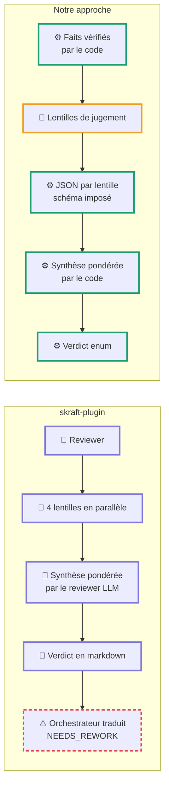

### Exemple déroulé

**skraft-plugin.** Le reviewer DELIVER lance ses quatre lentilles sur US-12. La lentille « portes de qualité » relit le fichier de preuves écrit par l'ingénieur et constate que la mutation n'a pas pu tourner en Swift : verdict `inconclusive`. La lentille « frontières d'architecture » lit le code et juge que le domaine est propre. Le reviewer applique sa table de synthèse, où une lentille inconclusive impose `NEEDS_REWORK`, et écrit son rapport avec `**Verdict:** NEEDS_REWORK`. L'orchestrateur doit alors traduire ce verdict en `CHANGES_REQUESTED`, seule valeur acceptée par l'état (C6), et relancer l'ingénieur, qui ne peut rien y faire puisque l'outil de mutation n'existe pas pour sa stack. La boucle tourne jusqu'à épuisement du budget.

**Notre approche.** Avant la revue, le code a déjà établi les faits : tests exécutés, mutation Muter à 100 %, règle de dépendance respectée, empreintes des tests intactes. Ces faits sont transmis aux lentilles comme acquis, et les lentilles ne jugent que ce qu'aucun outil ne peut juger : lisibilité, pertinence des tests, fidélité aux ADR. La lentille « portes de qualité » devient inutile, car ses vérifications sont faites par le code. Chaque lentille rend un JSON conforme à un schéma (verdict, liste de défauts avec gravité). Le code applique la même table de synthèse que skraft et produit un verdict parmi `APPROVED`, `CHANGES_REQUESTED`, `REJECTED`. Pour US-12, la lentille « lecteur à froid » signale que `MaxBolus` accepte une valeur négative : défaut de gravité moyenne, verdict `CHANGES_REQUESTED`, et le retour transmis à l'agent dev cite précisément le défaut.

### Fragilités de skraft

- La synthèse pondérée est une table appliquée par un LLM : correcte la plupart du temps, mais non garantie.
- Des lentilles vérifient des faits que du code établirait de façon certaine (portes de qualité, frontières d'architecture), en relisant des preuves écrites par l'agent revu.
- Vocabulaire du verdict différent de celui de l'état (C6), traduction laissée à l'orchestrateur.
- Un échec d'environnement (outil absent) produit une boucle de réessais sans issue.

### Améliorations

| Fragilité | Amélioration | Type |
| --- | --- | --- |
| Synthèse par un LLM | Même table de pondération, appliquée par le code | Code |
| Faits vérifiés par des LLM | Faits établis par le code, transmis aux lentilles comme acquis | Code |
| Vocabulaire divergent | Enum unique imposé par le schéma de sortie | Code |
| Échec d'environnement en boucle | Distinction entre défaut du travail (réessai) et défaut d'environnement (escalade immédiate) | Code |

On garde de skraft l'idée la plus précieuse : des lentilles indépendantes, en contextes neufs, dont une sans aucun contexte du producteur.

## Réessais, escalade et fin

**Rôle** : décider quoi faire après un rejet (réessayer, escalader, abandonner) et clore le pipeline.

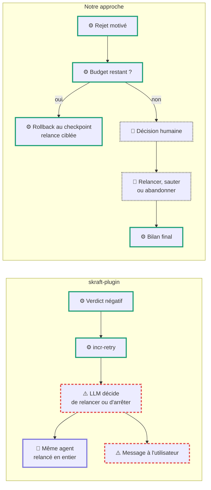

### Exemple déroulé

**skraft-plugin.** Après le `NEEDS_REWORK` de la revue DELIVER, l'orchestrateur appelle `state.mjs incr-retry`. Le compteur passe à 1, puis 2. Au troisième appel, le CLI renvoie `RETRY_EXHAUSTED`. C'est un signal déterministe, mais c'est le LLM qui doit le respecter : s'il le fait, il écrit un message à l'utilisateur et, selon son prompt, un commentaire sur l'issue GitHub. Entre deux essais, l'ingénieur est relancé sur toute la phase, avec ses modifications précédentes encore dans le dépôt.

**Notre approche.** Le défaut « `MaxBolus` accepte une valeur négative » provoque un rejet. Le réducteur vérifie le budget (1 essai utilisé sur 3), revient au commit vert du scénario 2, et relance l'agent dev avec un prompt ciblé : le défaut, le fichier, la ligne. Si le troisième essai échoue, la tâche passe en Décision humaine : l'utilisateur voit le motif, l'historique des tentatives, et choisit. À la fin, le code produit le bilan : trois scénarios terminés, sept commits, suite de 42 tests verte, mutation 100 % sur le domaine, un ADR ratifié, 38 requêtes consommées. Un résumé de quelques lignes est injecté dans la conversation principale.

### Fragilités de skraft

- L'arrêt au budget épuisé dépend de l'obéissance du LLM.
- Pas de retour à un point stable entre deux essais : chaque tentative hérite des erreurs de la précédente.
- Le réessai relance toute la phase au lieu de viser le défaut.
- Pas de bilan structuré en fin de pipeline.

### Améliorations

| Fragilité | Amélioration | Type |
| --- | --- | --- |
| Arrêt dépendant du LLM | Budget appliqué par le réducteur | Code |
| Essais cumulatifs | Rollback au dernier checkpoint vert avant chaque essai | Code |
| Réessai global | Relance ciblée avec le défaut précis | Code |
| Pas de bilan | Résultat structuré, carte de bilan et résumé pour la conversation | Code |

## Économies de tokens et de requêtes

Oui, il y a des économies possibles, mais il faut distinguer deux unités de coût, qui ne réagissent pas de la même façon.

- **Les tokens** : la taille du contexte envoyé au modèle et de sa réponse. Ils déterminent la latence, la qualité (un contexte trop long dégrade les réponses) et le coût quand on paie à l'usage.
- **Les requêtes** : avec Copilot, la facturation se compte en requêtes, chaque message envoyé à un agent en consommant une, multipliée par un coefficient selon le modèle. Les appels d'outils à l'intérieur d'un même tour ne comptent pas en plus. Le détail dépend de l'offre de l'utilisateur et reste à vérifier.

Notre approche fait nettement baisser les tokens. Sur les requêtes, elle peut coûter plus cher si on la découpe trop finement : c'est le principal arbitrage.

### Où l'on économise des tokens

| Levier | skraft-plugin | Notre approche | Ordre de grandeur |
| --- | --- | --- | --- |
| Skills de l'agent DELIVER | 10 skills déclarées, environ 12 900 mots | Les 5 skills qui servent à exécuter et prouver les portes disparaissent du contexte, puisque le code s'en charge | Environ 4 500 mots en moins par session DELIVER, soit près de 6 000 tokens |
| Orchestrateur | Prompt de 2 750 mots, plus les comptes rendus de tous les agents accumulés sur tout le pipeline | Aucun LLM orchestrateur | Tout ce contexte disparaît |
| Lentilles de revue | 4 lentilles, dont une qui relit les preuves de qualité | La lentille « portes de qualité » est remplacée par le code | Une session de revue en moins par phase revue |
| Exploration en RESEARCH | L'agent parcourt le dépôt | Fichiers candidats présélectionnés dans le dossier de passation | Moins de lectures et de recherches, donc moins de résultats d'outils dans le contexte |
| Réessais | Toute la phase relancée, erreurs précédentes encore présentes | Rollback, puis relance ciblée sur le défaut précis | Contexte de réessai beaucoup plus court |
| Échecs d'environnement | Trois essais complets avant arrêt (exemple de la mutation Swift) | Escalade immédiate | Trois relances complètes évitées |
| Sorties bavardes | Journal de cycle et checklist imprimés dans le chat à chaque cycle | Outils terminaux au schéma court | Réponses plus courtes |
| Prompt de l'architecte | 4 000 mots en une session | Deux sessions spécialisées plus courtes | Contexte réduit par session, au prix d'une requête de plus |

Les tailles sont mesurées sur les fichiers du dépôt (1 token vaut environ 1,3 mot en anglais). Les gains réels dépendent de ce que l'agent charge effectivement, certaines skills étant chargées à la demande.

### Ce qui coûte plus cher chez nous

Chaque nouvelle session renvoie son prompt système et ses skills, et relit les fichiers dont elle a besoin. Surtout, chaque message envoyé est une requête. Dans skraft, l'ingénieur enchaîne tous les cycles d'un scénario dans un seul tour : une requête. Si notre sous-machine ouvre une session pour chaque RED, GREEN et REFACTOR, un scénario de trois cycles coûte au moins neuf requêtes.

### La solution : contrôler par des outils, pas seulement par des sessions

On peut garder le contrôle déterministe sans multiplier les requêtes, en réglant la granularité :

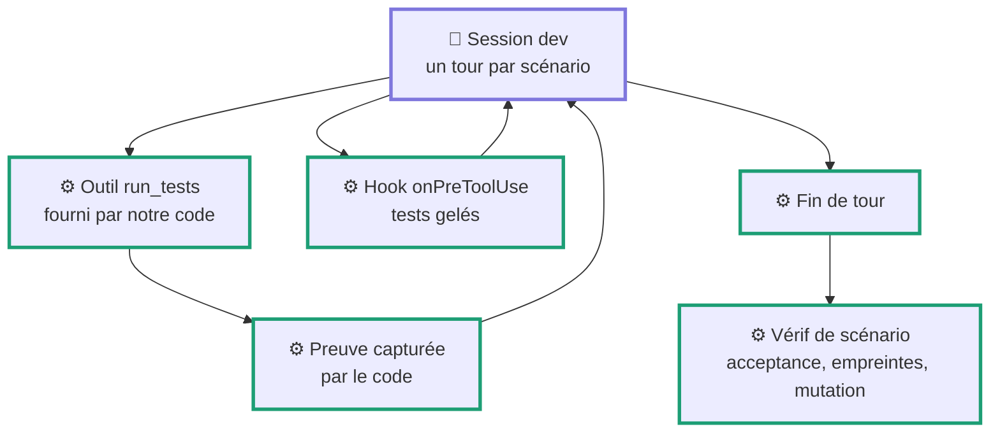

L'agent dev travaille tout un scénario en un seul tour, comme dans skraft. Mais il ne lance jamais les tests lui-même : il appelle un outil `run_tests` dont le handler est notre code, qui exécute, capture la sortie, le code de sortie et l'empreinte, et enregistre la preuve. Les hooks refusent toute modification des fichiers de test. En fin de tour, le code vérifie le scénario complet : acceptance verte, tests intacts, séquence rouge puis vert présente dans les preuves, mutation.

On obtient des preuves infalsifiables et l'intégrité des tests, pour environ une requête par scénario au lieu de neuf. La séparation stricte en sessions RED, GREEN et REFACTOR devient une option, à réserver aux niveaux `challenging` ou aux scénarios qui ont déjà échoué.

### Autres leviers

- **Modèle par rôle.** skraft annote déjà ses agents avec une classe de coût (researcher, planner, implementer). On la reprend, en réservant un modèle léger aux tâches mécaniques (proposition de difficulté, rendu des ADR) et un modèle fort à la conception et aux revues.
- **Prompts stables.** Des prompts système identiques d'une session à l'autre profitent de la mise en cache quand le fournisseur la propose.
- **Revue proportionnée.** Pour un niveau `simple`, deux lentilles suffisent (lecteur à froid et intégrité des tests), les faits étant déjà établis par le code.

### Mesurer plutôt qu'estimer

Le SDK remonte les événements d'usage de chaque session. Enregistrer, par état de la machine, les tokens envoyés et reçus, le nombre de requêtes et le nombre de réessais, puis comparer les deux approches sur trois à cinq stories réelles. C'est le seul moyen de chiffrer l'économie, car elle dépend fortement du taux de réessais, lui-même lié à la qualité des retours donnés aux agents.

## Synthèse et ordre de mise en œuvre

### Ce qui change, étape par étape

| Étape | Fragilité principale de skraft | Amélioration principale | Reste un jugement de LLM |
| --- | --- | --- | --- |
| Démarrage | Initialisation sur une phase inexistante | État sur `phaseOrder[0]`, slug stable, SHA de départ | Rien |
| Difficulté | Choix libre, saut de phase par édition manuelle | Indicateurs calculés, confirmation, routage par règle | Les cas limites |
| RESEARCH | Aucune vérification, citations inventées | Porte citations, questions ouvertes remontées tôt | Le fond de la recherche |
| DESIGN | Auto-réconciliation, ratification contournable | Porte cohérence, état Ratification bloquant | Le découpage et les décisions |
| DISTILL | Valeurs arrondies, rouge auto-déclaré | Porte valeurs, Porte RED exécutée, tous les tests d'acceptance écrits ici | La formulation des scénarios |
| DELIVER | Preuves auto-déclarées, examen et copie par le même agent, .NET seul | Preuves produites par le code, tests gelés, adaptateurs de stack | La qualité du code |
| Revue | Synthèse et faits établis par des LLM | Faits établis par le code, synthèse par le code | Lisibilité, pertinence, fidélité aux ADR |
| Réessais | Arrêt dépendant du LLM, essais cumulatifs | Budget, rollback, relance ciblée | Rien |

### Ordre de mise en œuvre

Chaque étape s'appuie sur la précédente, et chacune apporte un gain mesurable seule.

1. **Modèle d'état unifié et réducteur.** Une seule liste de phases, un seul schéma, un réducteur pur testé. Tout le reste en dépend.
2. **Adaptateur de stack Swift.** Exécution des tests, rapport JSON, mutation, analyse des imports. Sans lui, aucune porte ne peut tourner sur tes projets.
3. **DELIVER avec l'outil `run_tests` et les tests gelés.** Le plus gros gain de fiabilité, pour environ une requête par scénario.
4. **Porte RED et Porte valeurs en DISTILL.** Elles protègent l'entrée de DELIVER.
5. **Synthèse de revue par le code et suppression de la lentille « portes de qualité ».** Gain de fiabilité et de tokens immédiat.
6. **État Ratification bloquant et Porte cohérence en DESIGN.**
7. **Porte citations en RESEARCH et indicateurs de difficulté.**
8. **Instrumentation de l'usage** dès l'étape 3, pour mesurer les économies sur de vraies stories plutôt que de les estimer.

### Ce qu'on garde de skraft

Les 22 prompts d'agents et les 36 skills, qui portent la méthode (Event Modeling, DDD, double cycle TDD, lentilles adverses) ; les politiques pures de `domain/` une fois le modèle d'état unifié ; le schéma de preuves de qualité ; la commande `artifact adr` ; l'idée des lentilles en contextes neufs. Ce qu'on remplace, c'est le mécanisme qui décide et qui vérifie. La reprise de ce contenu suppose de valider la compatibilité avec sa licence GPL-3.0-or-later.
