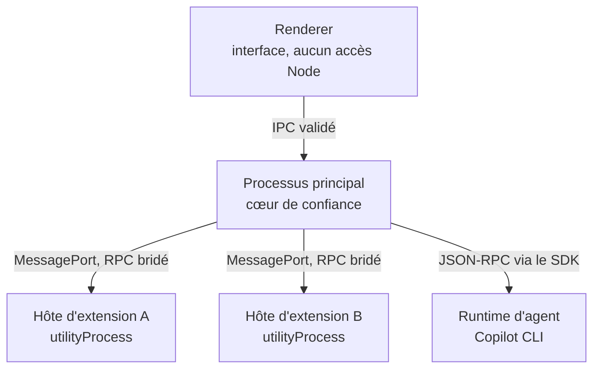
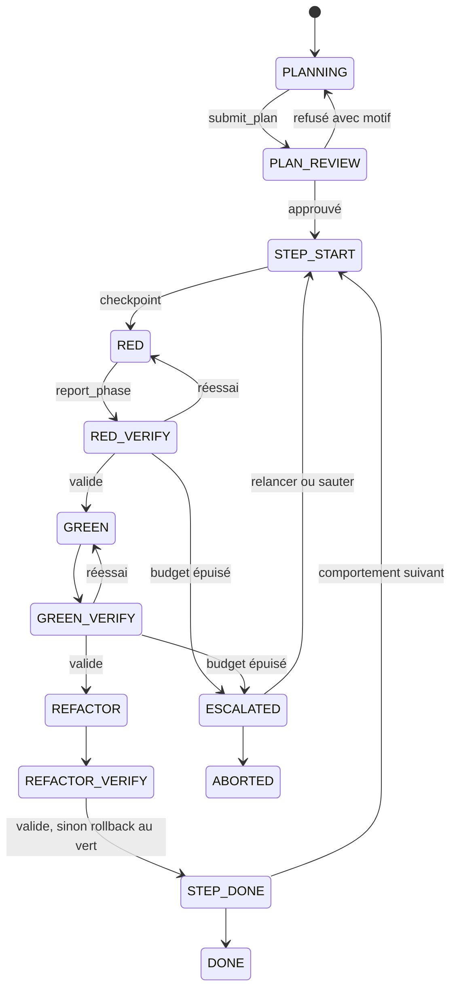
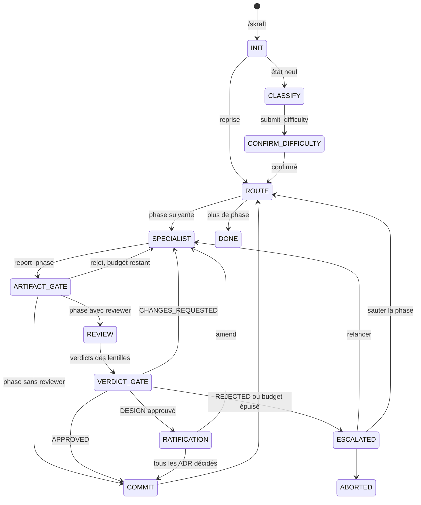

# SPEC — Application chat agentique extensible (nom de code : `agent-studio`)

> Document de référence pour démarrer le développement avec Claude Code.
> Il consolide la vision, toutes les décisions prises, l'architecture cible, le modèle d'extension,
> le moteur de tâches, les deux premières extensions (TDD et skraft) et la feuille de route.
> Version : 2026-09-23. Auteur : Samir.

---

## 0. Consignes pour Claude Code

1. **Lis ce document en entier avant d'écrire du code.** Les sections se répondent.
2. **Les décisions marquées `DÉCIDÉ` (section 3) ne se rediscutent pas pendant l'implémentation.** Si une décision te semble bloquante ou fausse, arrête-toi et pose la question au lieu de la contourner.
3. **Les décisions marquées `OUVERT` ne doivent pas être tranchées silencieusement.** Implémente derrière une interface ou une option de configuration, et signale le choix provisoire.
4. **Commence par le jalon J1 (section 15)**, dans l'ordre. Chaque jalon a des critères de sortie vérifiables : ne passe au suivant que lorsqu'ils sont tous remplis.
5. **Travaille en TDD** : un test qui échoue, le code minimal, le refactor. Le moteur de tâches et les réducteurs sont des fonctions pures, testables sans LLM, sans Git et sans disque.
6. **Consigne chaque décision technique nouvelle dans un ADR** sous `docs/adr/NNNN-titre.md` (format : contexte, décision, conséquences, statut).
7. **Vérifie les API des SDK sur la version installée** avant de t'y fier. Les points signalés `À VÉRIFIER` (section 16) ont été constatés sur une version donnée et peuvent avoir changé.
8. **Deux fichiers de référence accompagnent ce document** : `reference/tdd-orchestrator.ts` (machine à états TDD complète, compilée en TypeScript strict) et `reference/copilot-agents.ts` (adaptateur Copilot SDK : sessions par rôle, garde de périmètre, outils terminaux). Ce sont des prototypes à reprendre et découper, pas du code de production.
   La spécification détaillée de l'extension skraft est dans `SPEC-skraft.md`.
9. **Ne jamais exposer un objet du SDK à une extension** (voir D10). C'est la règle de sécurité la plus importante du projet.
10. **Aucun code propre à un langage hors des profils de stack** (section 8) : les extensions et le moteur de portes ne connaissent ni TypeScript, ni .NET, ni aucun autre langage.

---

## 1. Vision

Une **application de bureau locale** qui offre une interface de chat au-dessus d'un runtime d'agent IA (d'abord le **Copilot SDK**), et que l'on peut **augmenter par des extensions**, comme VS Code. Une extension apporte des commandes utilisables dans le chat (`/tdd`, `/skraft`), des agents et des skills nommés, des outils, des panneaux et des workflows longs.

Le principe directeur de tout le projet :

> **Le LLM propose, le code décide et vérifie.**
> Les workflows critiques sont des machines à états déterministes. Les agents produisent des artefacts ; des portes exécutées par le code les vérifient avant toute transition.

### 1.1 Publics

| Profil | Besoin principal |
| --- | --- |
| Testeur | Lancer et comprendre des tâches de test, lire des bilans |
| PO / BA | Rédiger et affiner des stories, suivre l'avancement |
| Développeur | Piloter des workflows de développement, voir le détail technique |
| Architecte | Ratifier les décisions d'architecture, revoir les conceptions |

Ces publics décrivent des besoins, pas des profils : depuis l'ADR 0087, l'application n'attribue
aucun profil et ne réserve aucune action à l'un d'eux.

Deux niveaux de lecture de l'interface servent ces publics : **mode simple** (non-développeurs) et **mode avancé** (développeurs). Voir section 12.

### 1.2 Hors périmètre (pour l'instant)

Marketplace en ligne, synchronisation multi-postes, édition collaborative, web app hébergée.

---

## 2. Glossaire

| Terme | Définition |
| --- | --- |
| Runtime d'agent | Ce qui exécute un agent LLM avec ses outils : Copilot SDK, Claude Agent SDK, agent ACP… |
| Session principale | La conversation visible par l'utilisateur, longue et persistante |
| Session de tâche | Une session éphémère ouverte par le code pour un rôle précis (agent test, agent dev…) |
| Extension | Paquet tiers signé qui contribue commandes, agents, skills, outils, panneaux, tâches |
| Hôte d'extensions | Processus isolé qui exécute une extension et lui expose l'API `ctx` |
| `ctx` | Seule API visible par une extension ; tous les appels sont tracés et arbitrés |
| Tâche | Workflow long, déterministe et reprenable, décrit par un réducteur pur |
| Réducteur | Fonction pure `transition(state, event) → { state, effects }` |
| Effet | Action à exécuter par le runner (lancer un agent, vérifier, commit, rollback, demander à l'humain) |
| Porte | Vérification exécutée par le code entre deux états (jamais par un LLM) |
| Outil terminal | Outil dont l'appel réussi termine le tour de l'agent ; sert de contrat de sortie structurée |
| Dossier de passation | Contexte explicite transmis à une nouvelle session (plan, étape, résumés, motif de rejet) |
| Checkpoint | SHA Git enregistré avant un effet, point de retour garanti |
| Profil de stack | Fichier déclaratif qui décrit, pour un projet, les commandes de test et de mutation, les formats de rapport, les emplacements, les motifs d'erreur et les couches d'architecture (section 8) |
| Parseur complémentaire | Petit module en bac à sable qui convertit un rapport non standard en résultats normalisés |
| Canari | Test généré exprès, dont le résultat attendu est connu, pour vérifier un profil |

---

## 3. Registre des décisions

### 3.1 Produit et plateforme

| # | Décision | Statut | Justification |
| --- | --- | --- | --- |
| D1 | Application **locale** sur le poste de l'utilisateur, pas de web app hébergée | DÉCIDÉ | Accès direct aux dépôts, au shell et aux outils de test |
| D2 | Stack **Electron** (TypeScript) | DÉCIDÉ | Écosystème Node du Copilot SDK, `utilityProcess` pour isoler les extensions |
| D3 | Premier runtime : **Copilot SDK** (`@github/copilot-sdk`), qui pilote le binaire Copilot CLI en JSON-RPC | DÉCIDÉ | Abonnement Copilot de l'utilisateur, SDK riche (hooks, outils, permissions) |
| D4 | Authentification GitHub via **GitHub CLI** (`gh auth login`), plutôt qu'une OAuth App ou `copilot login` | DÉCIDÉ | Réutilise un outil standard, jetons gérés hors de l'application |
| D5 | Interface pensée pour **non-développeurs et développeurs** : mode simple et mode avancé | DÉCIDÉ | Public mixte (section 1.1) |
| D6 | ~~Un utilisateur ne peut pas changer lui-même de profil (rôle) ; le profil est attribué par un administrateur~~ | REMPLACÉ par l'ADR 0087 (2026-11-13) : plus de profil, aucune action réservée | Règle produit |
| D7 | Gestion Git **simplifiée** intégrée : connexion au dépôt, clonage, push, synchronisation, checkpoints, annulation | DÉCIDÉ | Les non-développeurs doivent pouvoir travailler sans connaître Git |

### 3.2 Extensions

| # | Décision | Statut | Justification |
| --- | --- | --- | --- |
| D8 | Système d'extensions **à la VS Code**, extensions écrites par des **tiers / la communauté** | DÉCIDÉ | Écosystème ouvert |
| D9 | **Un processus par extension** (`utilityProcess.fork()`), jamais dans le renderer ni dans le processus principal | DÉCIDÉ | Code tiers non fiable ; un plantage n'emporte ni l'UI ni le cœur |
| D10 | L'extension ne voit que l'API **`ctx`** ; **aucun objet du SDK ne lui est jamais exposé** | DÉCIDÉ | Exposer une session permettrait de contourner hooks, permissions et périmètres |
| D11 | Manifeste déclaratif avec **permissions contraignantes** : une capacité non déclarée est refusée même si l'utilisateur l'autorise | DÉCIDÉ | Surface d'attaque connue à l'installation |
| D12 | Capacités **nommées et adressables** (`<extension>/<nom>`, alias court sans collision) dans un **registre unique** | DÉCIDÉ | Commandes, agents, skills et outils invocables par leur nom |
| D13 | Paquets **signés**, API `ctx` en **semver** (`engines.appApi`), **liste de révocation** signée dès la première version publique | DÉCIDÉ | Distribution à des tiers |
| D14 | La **version 1.0 publique de l'API** ne sort qu'après au moins deux extensions réelles (TDD puis skraft) écrites en interne | DÉCIDÉ | Éviter de figer une API immature |
| D15 | Langage des extensions : **JavaScript/TypeScript seul** au départ | OUVERT | Un protocole RPC ouvert à d'autres langages est possible plus tard |

### 3.3 Orchestration et contrôle

| # | Décision | Statut | Justification |
| --- | --- | --- | --- |
| D16 | **Orchestrateur déterministe** : réducteur pur + runner d'effets. Le LLM ne choisit jamais la transition suivante | DÉCIDÉ | Contrôle positif ; les hooks seuls ne font qu'un contrôle négatif (leçon de skraft-plugin) |
| D17 | **Une session neuve par phase ou par rôle**, avec un **dossier de passation** explicite construit par le code | DÉCIDÉ | Contexte propre, prévisible, débogable ; réessais sans pollution |
| D18 | Sorties des agents par **outils terminaux** à schéma (`report_phase`, `submit_plan`, `submit_verdict`, `submit_difficulty`, `report_blocker`) | DÉCIDÉ | Contrat structuré entre LLM et code, pas de parsing de texte libre |
| D19 | **Portes vérifiées par le code** : exécution des tests, diff Git, empreintes des fichiers de test, périmètres d'écriture | DÉCIDÉ | Seule garantie indépendante du modèle et du runtime |
| D20 | **Preuves produites par le code** : l'agent n'exécute jamais les tests lui-même, il appelle l'outil `run_tests` dont le handler est notre code | DÉCIDÉ | Preuves infalsifiables par l'agent |
| D21 | **Tests gelés par empreinte** : l'agent dev ne peut jamais modifier un test ; toute suppression de test est une proposition soumise à validation | DÉCIDÉ | Intégrité du TDD |
| D22 | **Granularité réglable** : par défaut un tour d'agent par scénario (contrôle par outils et hooks dans le tour) ; sessions séparées RED / GREEN / REFACTOR en option | DÉCIDÉ | Environ une requête par scénario au lieu de neuf, sans perdre les garanties |
| D23 | **Checkpoint Git avant chaque effet** ; tout effet interrompu est rejoué depuis son checkpoint, jamais « récupéré » | DÉCIDÉ | Reprise fiable après crash, veille ou fermeture |
| D24 | **Budget de réessais appliqué par le réducteur**, rollback avant chaque essai, relance ciblée avec le motif précis ; escalade vers l'humain à épuisement | DÉCIDÉ | L'arrêt ne dépend pas de l'obéissance du LLM |
| D25 | Distinction **défaut de travail** (réessai) / **défaut d'environnement** (escalade immédiate) | DÉCIDÉ | Ne pas brûler le budget sur un outil absent ou une API indisponible |
| D26 | **Skills obligatoires injectées** dans la configuration de session ; skills facultatives via un outil `load_skill` tracé ; le contrôle porte sur **l'application** des règles (effets vérifiables), pas sur la lecture | DÉCIDÉ | Remplace le contrôle G3 de skraft par une garantie par construction |

### 3.4 Sécurité, permissions, interaction

| # | Décision | Statut | Justification |
| --- | --- | --- | --- |
| D27 | **Arbitre de permissions unique** dans le processus principal ; un seul `onPermissionRequest` et une seule chaîne de hooks par session, composés par le cœur | DÉCIDÉ | Point d'arbitrage unique, traçable |
| D28 | Chaîne de hooks : exécution en série, **le premier refus l'emporte**, délai maximal par hook, et **refus par défaut** en cas d'exception ou de délai pour les gardes de sécurité | DÉCIDÉ | Côté SDK, une exception de hook reprend le comportement par défaut : un refus qui plante deviendrait une autorisation |
| D29 | Le service **Workspace** est le seul à toucher le disque et Git ; les extensions passent par lui | DÉCIDÉ | Retour arrière toujours possible |
| D30 | Pas de délai fixe sur le travail des agents : **surveillance d'inactivité** (événements de session, progression des outils longs) | DÉCIDÉ | Un agent qui travaille ne doit pas être coupé |
| D31 | **Jamais d'attente bloquante sur l'humain** : les décisions longues sont des **demandes d'interaction persistées** ; en session de tâche, pas de `ask_user`, mais l'outil terminal `report_blocker` | DÉCIDÉ | Un tour ouvert pendant des heures expire |
| D32 | Communication vers l'utilisateur en trois canaux : `ctx.chat` (immédiat), handlers SDK (questions d'agent en session interactive), demandes d'interaction persistées (décisions longues) | DÉCIDÉ | Voir section 7 |
| D33 | Progression : **une carte de tâche mise à jour en place**, des **jalons**, des **alertes** ; messages générés depuis les états déclarés dans le manifeste ; jamais injectés dans le contexte du LLM | DÉCIDÉ | Lisibilité et économie de tokens |
| D34 | Les extensions ne rendent que du **markdown assaini** et des **types de cartes déclarés** ; elles ne peuvent pas imiter une demande de permission | DÉCIDÉ | Anti-hameçonnage |

### 3.5 Portabilité et coûts

| # | Décision | Statut | Justification |
| --- | --- | --- | --- |
| D35 | Port **`AgentRuntime`** avec déclaration de capacités ; adaptateurs : Copilot SDK (J1), puis Claude Agent SDK, puis client ACP | DÉCIDÉ (port) / OUVERT (ordre des adaptateurs suivants) | Généraliser à d'autres IA sans toucher au cœur |
| D36 | Contrôle en deux couches : **prévention** (hooks, permissions — dépend du runtime) et **détection** (portes — indépendantes) ; sans hooks, le moteur renforce la détection après chaque tour | DÉCIDÉ | Dégradation propre sur un runtime moins riche |
| D37 | **Instrumentation de l'usage** par état de machine (tokens, requêtes, réessais), affichée dans l'unité du fournisseur | DÉCIDÉ | Chiffrer les économies au lieu de les estimer |
| D38 | Choix du **modèle par rôle** (fort pour conception et revues, léger pour tâches mécaniques) et **politique de fournisseur par projet** | DÉCIDÉ (choix du modèle par l'utilisateur, ADR 0020) / OUVERT (par rôle, fournisseur) | Coût et confidentialité. Le Copilot CLI n'honore pas encore le modèle demandé : mesures dans l'ADR 0020 |
| D39 | Nom définitif de l'application | OUVERT | « Copilot Studio » est déjà un produit Microsoft : à éviter |

### 3.6 Extension skraft

| # | Décision | Statut | Justification |
| --- | --- | --- | --- |
| D40 | skraft est porté comme **extension**, avec son pipeline RESEARCH → DESIGN → DISTILL → DELIVER piloté par notre réducteur | DÉCIDÉ | Voir section 10 |
| D41 | Réutiliser ses prompts d'agents, ses skills (36 en 1.5.2, 38 en 1.6.0), politiques pures de `domain/`, schéma de preuves et commande `artifact adr` **après unification du modèle d'état** | DÉCIDÉ (sous réserve D42) | Méthode riche, mécanisme de contrôle défaillant |
| D42 | Compatibilité de la licence **GPL-3.0-or-later** de skraft avec la distribution de l'extension | DÉCIDÉ (ADR 0012, option C : autorisation de l'auteur) | Reprise non commencée : trace écrite, licence de redistribution et dépôt source restent à réunir |

### 3.7 Profils de stack

| # | Décision | Statut | Justification |
| --- | --- | --- | --- |
| D43 | Tout ce qui dépend du langage est externalisé dans un **profil de stack déclaratif** versionné dans le dépôt ; aucune extension ne contient de code propre à un langage | DÉCIDÉ | Extensions génériques ; nouvelle stack sans écrire d'adaptateur |
| D44 | Le moteur ne lit que des **formats standards** (JUnit XML, TAP, rapport de mutation Stryker) ; un parseur complémentaire n'est écrit que pour un outil qui n'en produit aucun | DÉCIDÉ | Couverture large avec un seul moteur |
| D45 | Les capacités d'un profil sont **déclarées** ; une porte sans capacité est « non disponible », jamais un échec, et la politique du projet décide (`ignore`, `warn`, `require-decision`) | DÉCIDÉ | Éviter les boucles de réessais sans issue (défaut observé dans skraft) |
| D46 | Le profil peut être **généré par un agent** (`/stack init`), mais il n'est adopté qu'après **vérification par exécution** (`/stack doctor`), avec tests canaris dont le résultat est connu d'avance | DÉCIDÉ | Le LLM propose, le code vérifie |
| D47 | Les commandes du profil sont la **liste blanche** de `shell:test` ; toute modification du profil exige une confirmation ; exécution de vérification en worktree isolé | DÉCIDÉ | Le profil définit ce qui s'exécute sur la machine |
| D48 | Les parseurs complémentaires sont des fonctions pures exécutées en **bac à sable**, avec fixtures rejouées | DÉCIDÉ | Code généré par un LLM, donc non fiable par défaut |

---

## 4. Architecture

### 4.1 Modèle de processus



| Processus | Contenu | Confiance | Isolation |
| --- | --- | --- | --- |
| Renderer | Chat, cartes, panneaux, diff | Code de l'application | `contextIsolation: true`, `nodeIntegration: false`, `sandbox: true`, CSP stricte |
| Principal | Registre, routeur, sessions, moteur de tâches, arbitre, Workspace, bus d'événements, client SDK | Totale | Seul à écrire sur le disque et à appeler le SDK |
| Hôte d'extension | Une extension | Nulle | `utilityProcess.fork()`, modèle de permissions Node (`--permission`, lecture limitée au dossier de l'extension), budget mémoire, délai par appel |
| Runtime d'agent | Binaire lancé par le SDK | Fournisseur | Jamais exposé aux extensions |

Règles de communication :
- Renderer ↔ principal : preload minimal, canaux nommés via `contextBridge`, validation de schéma (taille, forme, origine) de chaque message côté principal.
- Principal ↔ extension : requête/réponse avec identifiant d'appel, délai maximal, annulation ; les opérations longues passent par des messages asynchrones.
- Redémarrage d'un hôte d'extension : au plus trois fois par heure, puis désactivation de l'extension pour la session, avec message à l'utilisateur nommant l'extension.

### 4.2 Services du cœur (processus principal)

| Service | Responsabilité |
| --- | --- |
| Registre des capacités | Indexe par nom commandes, agents, skills, outils, panneaux, tâches, serveurs MCP. Seule source pour composer une session |
| Routeur d'intention | `/commande` → handler d'extension ; `@agent` → session de tâche ; texte libre → session principale enrichie ; action de panneau → handler |
| Gestionnaire de sessions | Session principale (persistante, reprise au lancement) ; sessions de tâche (éphémères, fermées puis supprimées) ; limite de parallélisme ; purge des sessions orphelines au démarrage |
| Moteur de tâches | Exécute les réducteurs des extensions : persistance, effets, reprise, annulation, délais, budget |
| Arbitre de permissions | Manifeste → règles utilisateur → politique de permissions (`admin.json`, ADR 0087) → demande à l'écran. Fournit l'unique `onPermissionRequest` et compose les hooks |
| Workspace | Lecture/écriture sous la racine du projet, commandes, checkpoints, diff, commit, rollback, branches |
| Bus d'événements et journal | Timeline unique : messages, appels d'outils, transitions, vérifications, décisions de permission ; sert à l'affichage, la reprise, l'audit, le bilan |
| Interactions | Demandes d'interaction persistées, liste « En attente de vous », notifications système |
| Usage | Compteurs par tâche et par état : tokens, requêtes, réessais, durée |

### 4.3 Port `AgentRuntime`

Le cœur ne dépend jamais directement d'un SDK. Chaque runtime est un adaptateur.

```ts
export interface AgentRuntime {
  id: "copilot-sdk" | "claude-agent-sdk" | "acp";
  capabilities: {
    inProcessHooks: boolean;                          // hooks en code avant/après outil
    customTools: "native" | "mcp";                    // comment fournir run_tests, report_phase…
    terminalTool: "native" | "stop-hook" | "reprompt";// comment forcer la sortie structurée
    fileMediation: boolean;                           // les écritures passent-elles par nous ?
    usageUnit: "requests" | "tokens";
  };
  start(): Promise<void>;
  openSession(cfg: AgentSessionConfig): Promise<AgentSession>;
  deleteSession(id: string): Promise<void>;
}

export interface AgentSessionConfig {
  role: string;                         // "tdd-test", "skraft-architect"…
  model?: string;
  workingDirectory: string;
  systemPrompt: string;                 // rôle + skills obligatoires injectées + dossier de passation
  tools: ToolSpec[];                    // outils fournis par notre code
  writablePaths: RegExp[];              // périmètre d'écriture du rôle
  hooks: ComposedHooks;                 // composés par l'arbitre, jamais par l'extension
}

export interface AgentSession {
  id: string;
  send(prompt: string): Promise<void>;  // non bloquant
  onEvent(cb: (e: AgentEvent) => void): () => void;
  abort(): Promise<void>;
  close(): Promise<void>;
}
```

Correspondances connues :

| Besoin | Copilot SDK | Claude Agent SDK | ACP |
| --- | --- | --- | --- |
| Session | `createSession` | un `query()` par phase, reprise par id | `session/new` |
| Outils | `defineTool` | `tool()` + `createSdkMcpServer` | serveur MCP transmis à `session/new` |
| Hooks | `hooks.onPreToolUse`… | callbacks de hooks en processus | aucun ; détection renforcée |
| Permissions | `onPermissionRequest` | `canUseTool`, `permissionMode` | `session/request_permission` |
| Outil terminal | `isTerminal: true` | hook `Stop` qui refuse l'arrêt | relance par nouveau prompt |
| Auth / coût | abonnement Copilot, requêtes | clé API ou cloud (Bedrock, Vertex, Foundry), tokens ; pas de connexion claude.ai pour une app tierce sans accord | selon l'agent |

Seul l'adaptateur Copilot SDK est dans le périmètre des premiers jalons. Les autres restent des interfaces documentées.

### 4.4 Arborescence proposée (monorepo pnpm)

```
agent-studio/
├── apps/
│   └── desktop/                 # Electron : main, preload, renderer
│       ├── src/main/            # bootstrap, IPC, fenêtres
│       ├── src/preload/
│       └── src/renderer/        # UI (framework à choisir, voir OUVERT O7)
├── packages/
│   ├── core/                    # registre, routeur, sessions, arbitre, bus, interactions, usage
│   ├── task-engine/             # réducteurs, runner d'effets, persistance, watchdog
│   ├── workspace/               # fs + Git (checkpoints, diff, rollback)
│   ├── runtime-copilot/         # adaptateur AgentRuntime pour le Copilot SDK
│   ├── extension-host/          # lancement utilityProcess, RPC, cycle de vie
│   ├── extension-api/           # types publics de ctx (publié pour les tiers)
│   ├── extension-manifest/      # schéma JSON du manifeste + validation
│   └── stack-profiles/          # moteur générique : lecteurs JUnit/TAP/Stryker, classification, imports,
│                                #   schéma stack-profile@1, /stack init, /stack doctor, bac à sable des parseurs
├── profiles/                    # profils d'exemple (typescript-vitest, dotnet) et gabarits de canaris
├── extensions/
│   ├── tdd/                     # première extension interne (jalon J2)
│   └── skraft/                  # deuxième extension (jalons S1 à S6)
├── reference/                   # prototypes fournis avec cette spec
└── docs/adr/
```

---

## 5. Modèle d'extension

### 5.1 Manifeste

```jsonc
{
  "id": "diabeo.tdd",
  "version": "1.0.0",
  "publisher": "diabeo",
  "engines": { "appApi": "^0.1" },
  "main": "dist/index.js",
  "activationEvents": ["onCommand:tdd", "onAgent:tdd-test"],
  "permissions": [
    "fs:read",
    "fs:write:src/**", "fs:write:tests/**",
    "git:commit", "shell:test",
    "copilot:sessions",
    "net:none"
  ],
  "contributes": {
    "commands": [{ "name": "tdd", "title": "Implémenter en TDD", "handler": "runTdd" }],
    "agents":   [{ "name": "tdd-test", "role": "roles/test.md", "tools": ["run_tests", "report_phase"], "write": ["tests/**"] }],
    "skills":   [{ "name": "tdd-cycle", "path": "skills/tdd-cycle", "mandatoryFor": ["tdd-test", "tdd-dev"] }],
    "tools":    [{ "name": "verify_red", "handler": "verifyRed", "description": "Vérifie qu'un test échoue pour la bonne raison" }],
    "panels":   [{ "id": "tdd.progress", "title": "Progression TDD" }],
    "tasks": [{
      "name": "tdd-cycle",
      "handler": "tddTask",
      "states":     { "RED": "Écriture du test", "GREEN": "Écriture du code", "REFACTOR": "Nettoyage" },
      "milestones": ["STEP_DONE", "DONE"],
      "alerts":     ["RETRY", "TIMEOUT", "ESCALATED"]
    }]
  }
}
```

Le schéma JSON du manifeste vit dans `packages/extension-manifest` et est validé à l'installation et au démarrage. Toute extension doit fournir, pour chaque action visible, un **titre court et une description en langage naturel** (critère d'entrée au registre, D5).

### 5.2 Permissions

| Permission | Effet |
| --- | --- |
| `fs:read` | Lecture sous la racine du projet |
| `fs:write:<glob>` | Écriture limitée aux chemins déclarés |
| `shell:test` | Commandes déclarées dans le profil de stack approuvé uniquement (D47) |
| `shell:<liste>` | Commandes explicitement listées |
| `git:commit`, `git:branch`, `git:revert` | Opérations Git via Workspace |
| `copilot:sessions` | Ouvrir des sessions de tâche (consomme le quota de l'utilisateur) |
| `net:<domaines>` | Réseau vers des domaines listés ; `net:none` par défaut |

Une mise à jour d'extension qui élargit les permissions exige un nouvel accord de l'utilisateur.

### 5.3 Cycle de vie

1. **Installation** : vérification de signature, compatibilité `engines.appApi`, affichage des permissions en langage clair, accord.
2. **Enregistrement** : au démarrage, lecture du manifeste et indexation des contributions sans charger le code.
3. **Activation** : au premier événement déclencheur, lancement de l'hôte et appel de `activate(ctx)`.
4. **Désactivation** : `deactivate()`, puis arrêt du processus après un délai de grâce.

### 5.4 API `ctx`

| Espace | Méthodes principales | Permission |
| --- | --- | --- |
| `ctx.chat` | `registerCommand`, `stream`, `progress`, `confirm`, `pick`, `input`, `taskCard`, `milestone`, `alert`, `card` | aucune |
| `ctx.agents` | `run(name, prompt, opts)` → résultat sérialisé (jamais une session) | `copilot:sessions` |
| `ctx.workspace` | `readFile`, `writeFile`, `listFiles`, `run(cmd)`, `checkpoint`, `diff`, `hashFiles` | `fs:*`, `shell:*` |
| `ctx.git` | `commit`, `branch`, `revertTo`, `head` | `git:*` |
| `ctx.tools` | `register(tool)` | aucune |
| `ctx.hooks` | `onPreToolUse`, `onPostToolUse` (ne peuvent que refuser ou restreindre, jamais élargir) | aucune |
| `ctx.tasks` | `start(name, input)`, `dispatch(taskId, event)`, `onProgress`, `cancel`, `status` | selon la tâche |
| `ctx.interactions` | `request({ kind, title, options, context })` → identifiant ; réponse livrée comme événement de tâche | aucune |
| `ctx.panels` | `update(id, data)`, `onAction` | aucune |
| `ctx.storage` | `get`, `set` (espace privé à l'extension) | aucune |
| `ctx.settings` | `get`, `onChange` | aucune |
| `ctx.stack` | `profile()`, `capabilities()`, `runTests(scope)`, `runMutation(scope)`, `checkArchitecture()`, `resolvePaths(kind)` — résultats normalisés (8.3) | `shell:test` |

### 5.5 Composition des hooks

Le SDK n'accepte qu'un handler par type de hook et par session. Le cœur chaîne ceux des extensions actives :

```ts
onPreToolUse: async (input, inv) => {
  for (const h of registry.preToolHooks(session)) {
    let r;
    try { r = await withTimeout(h.fn(input, inv), 2_000); }
    catch (err) {
      journal.hookFailure(h.extensionId, err);
      if (h.securityGuard) return { permissionDecision: "deny", permissionDecisionReason: `Garde ${h.id} indisponible` };
      continue;
    }
    if (r?.permissionDecision === "deny") return r;          // le premier refus l'emporte
    if (r?.modifiedArgs) input.toolArgs = r.modifiedArgs;    // restriction seulement
  }
  return { permissionDecision: "allow", modifiedArgs: input.toolArgs };
}
```

Les gardes internes du cœur (périmètre d'écriture par rôle, gel des tests, commandes Git interdites aux agents) passent **avant** les hooks d'extension et ne peuvent pas être désactivées par une extension.

---

## 6. Moteur de tâches

### 6.1 Contrat d'une tâche

```ts
export interface TaskDefinition<S, E, F> {
  name: string;
  initialState(input: unknown): S;
  transition(state: S, event: E): { state: S; effects: F[] };   // PUR : aucune I/O
  runEffect(effect: F, deps: TaskDeps): Promise<E | void>;        // exécute et renvoie l'événement suivant
}
```

Le moteur fournit : file d'événements, persistance de l'état **après chaque transition**, émission des événements vers le bus (cartes, jalons, alertes), budget, watchdog, annulation, reprise.

### 6.2 Événements système injectés par le moteur

| Événement | Quand |
| --- | --- |
| `TIMEOUT` | Inactivité d'un agent ou d'une commande au-delà du seuil |
| `ENV_FAILURE` | Outil absent, runtime injoignable, quota épuisé, API indisponible |
| `HUMAN_DECISION` | Réponse à une demande d'interaction persistée |
| `RESUMED` | Redémarrage de l'application avec un effet commencé non terminé |
| `ABORT` | Annulation par l'utilisateur |

Le réducteur traite `TIMEOUT` comme un rejet (réessai ciblé si budget) et `ENV_FAILURE` comme une escalade immédiate (D25).

### 6.3 Reprise (D23)

Avant chaque effet, le moteur persiste un marqueur `{ effect, checkpoint, attempt, startedAt }`. Au redémarrage, un effet commencé mais non terminé déclenche : rollback au checkpoint, puis événement `RESUMED` et relance de l'effet. Aucun travail partiel n'est réutilisé.

### 6.4 Exécution d'un tour d'agent (D30, amendé par l'ADR 0026)

Pas de `sendAndWait` avec délai fixe. Le tour est lancé avec `send()` ; tout événement de session réarme un chronomètre d'inactivité ; `session.idle` termine le tour ; un silence au-delà du seuil déclenche `abort()` et l'événement `TIMEOUT`. Les outils longs (`run_tests`) réarment le chronomètre à chaque ligne de sortie.

Au-dessus de ce chronomètre, un **plafond de durée totale** du tour (défaut 30 min, ADR 0026), que **rien ne réarme** et qui lève `TurnBudgetError`. Le chronomètre d'inactivité ne voit pas un agent qui parle sans avancer : le 28/09, un tour a duré 1 h 55 avant que le silence ne finisse par le trahir. L'activité n'est pas la progression.

Et un **plafond de coût** (défaut 1 M tokens d'entrée cumulés, ADR 0027), lu en direct sur l'événement `usage`, qui lève `TurnCostError`. Chaque appel renvoie tout le contexte : un tour de N appels coûte en O(N²). Durée et coût sont indépendants — un tour peut être bref et ruineux.

```ts
async function runTurn(session: AgentSession, prompt: string, idleMs = 5 * 60_000) {
  return new Promise<void>((resolve, reject) => {
    let timer = setTimeout(onIdle, idleMs);
    const off = session.onEvent((ev) => {
      clearTimeout(timer); timer = setTimeout(onIdle, idleMs);
      if (ev.type === "idle") { cleanup(); resolve(); }
      if (ev.type === "error") { cleanup(); reject(new EnvFailure(ev.message)); }
    });
    async function onIdle() { cleanup(); await session.abort(); reject(new TurnTimeout()); }
    function cleanup() { clearTimeout(timer); off(); }
    session.send(prompt).catch((e) => { cleanup(); reject(e); });
  });
}
```

### 6.5 Outils standard fournis aux agents par le cœur

| Outil | Rôle | Particularité |
| --- | --- | --- |
| `run_tests` | Lance la suite ou un sous-ensemble via le profil de stack | Handler = notre code : capture sortie, code de sortie, empreintes, écrit la preuve (D20) |
| `report_phase` | Clôt la phase avec un résumé et la liste des fichiers | Terminal ; **refuse** (erreur) si une skill à la demande requise n'a pas été chargée ou si une précondition manque |
| `report_blocker` | Signale une question métier bloquante avec des choix | Terminal ; suspend la tâche et crée une demande d'interaction (D31) |
| `load_skill` | Charge une skill facultative, éventuellement une section | Chaque appel est tracé dans l'état de la tâche (D26) |
| `submit_plan`, `submit_verdict`, `submit_difficulty` | Sorties structurées spécialisées | Terminales, schéma strict, enums fermés. Le verdict s'appelle `submit_lens_verdict` dans le code |
| `submit_pile` | Pile proposée par l'agent de découverte : une par racine, en YAML, avec sa justification (ADR 0076) | Terminale ; le code vérifie la pile en l'exécutant avant que rien ne soit écrit |

### 6.6 Dossier de passation (D17)

Construit par le code à chaque ouverture de session :

```
Tâche : <nom> — <story>
Plan : [done] …  [en cours] …  [pending] …
Étape en cours : <comportement / phase>
Déjà fait : - <résumé report_phase> (<fichiers>)
Rejet précédent : <motif précis de la porte>, s'il y a lieu
Réponses utilisateur : <décisions ratifiées, réponses aux blocages>
Fichiers utiles : <présélection par le code>
```

Les transcriptions des sessions ne sont **jamais** réinjectées. À la fin d'une tâche, seul un **résumé structuré** remonte à la session principale : comme résultat d'outil si le LLM a lancé la tâche, sinon comme `additionalContext` du message suivant de l'utilisateur. Un outil `task_status` permet au LLM principal de lire l'état courant à la demande.

---

## 7. Communication avec l'utilisateur

### 7.1 Trois canaux (D32)

| Canal | Usage | Mécanisme |
| --- | --- | --- |
| `ctx.chat` | Progression, cartes, questions courtes avec l'utilisateur présent | Messages validés par l'hôte, origine affichée |
| Questions d'agent en direct | Session interactive uniquement | Handlers `onUserInputRequest` (outil `ask_user`) et `onElicitationRequest` du SDK, implémentés par le processus principal |
| Demandes d'interaction persistées | Ratification, confirmation de difficulté, escalade, blocage métier | Enregistrement persistant, liste « En attente de vous », notification système, survit au redémarrage |

Forme d'une demande d'interaction :

```json
{
  "id": "int-42", "taskId": "us-12", "extension": "skraft",
  "kind": "decision",
  "title": "Ratifier ADR-008 : plafond appliqué dans le domaine",
  "options": ["accept", "reject", "amend"],
  "context": { "adr": "docs/adr/adr-008-plafond-domaine.md" },
  "createdAt": "2026-09-22T14:03:00Z",
  "status": "pending"
}
```

La réponse est validée (option autorisée ; n'importe qui peut répondre, ADR 0087) puis injectée comme `HUMAN_DECISION` dans la tâche. Des rappels sont envoyés ; au-delà d'une durée configurable, la tâche passe en pause (pas en échec).

### 7.2 Progression (D33)

- **Carte de tâche** : une seule par tâche, mise à jour en place (phase, étape, progression, temps écoulé, usage). Rafraîchie au plus deux fois par seconde.
- **Jalons** : messages persistants aux transitions déclarées `milestones`. Au-delà d'un jalon toutes les dix secondes par tâche, regroupement en résumé.
- **Alertes** : transitions déclarées `alerts` (réessai, délai, escalade), mises en évidence.
- **Mode simple** : carte et jalons. **Mode avancé** : en plus, chaque étape, appel d'outil et vérification.
- **Hors conversation** : panneau « Tâches en cours » avec badge ; notification système pour jalons et alertes seulement, si l'application est en arrière-plan.
- Les libellés viennent du manifeste (`states`) : le moteur génère cartes, jalons et alertes automatiquement.
- Chaque mise à jour de carte sert aussi de signal de vie pour le watchdog.

---

## 8. Profils de stack

Tout ce qui dépend du langage ou de l'outillage d'un projet est **externalisé dans un profil de stack**, un fichier déclaratif. Les extensions et le moteur de portes ne contiennent aucune connaissance propre à un langage.

### 8.1 Trois couches

| Couche | Nature | Contenu |
| --- | --- | --- |
| Moteur de portes | Code du cœur, générique | Lancer une commande, lire un rapport dans un format standard, classer les échecs, analyser les imports, appliquer seuils et règles |
| Profil de stack | Données (YAML), versionnées dans le dépôt | Commandes, emplacements, formats de rapport, motifs d'erreur, couches d'architecture, consignes pour les agents |
| Parseur complémentaire | Petit module, en bac à sable | Uniquement pour un outil qui ne produit aucun format standard |

### 8.2 Format du profil

Fichier `.agent-studio/stack.yaml` à la racine du projet, validé par le JSON Schema `stack-profile@1` (publié par `packages/stack-profiles`). *Depuis l'ADR 0071 : section `pile` de `.agent-studio/projet.yaml` ; `stack.yaml` n'est plus relu que pendant la transition.*

```yaml
schema: agent-studio/stack-profile@1
name: dotnet
detect: ["*.sln", "*.csproj"]

paths:
  sources: ["src/**"]
  unitTests: ["tests/**/*UnitTests/**"]
  acceptanceTests: ["tests/**/*AcceptanceTests/**"]

tests:
  run: "dotnet test --logger \"junit;LogFilePath=TestResults/junit.xml\""
  runOne: "dotnet test --filter {testId} --logger \"junit;LogFilePath=TestResults/junit.xml\""
  report: { format: junit-xml, path: "TestResults/junit.xml" }
  timeoutSeconds: 600
  failureKinds:
    missingSymbol: ["CS0103", "CS0246", "CS0117"]
    syntax: ["CS1002", "CS1513"]

mutation:
  run: "dotnet stryker --reporter json"
  report: { format: stryker-json, path: "StrykerOutput/**/mutation-report.json" }
  thresholds: { Domain: 100, Application: 100, Infrastructure: 90 }

architecture:
  imports: '^\s*using\s+([\w.]+)\s*;'
  layers:
    Domain:         { paths: ["src/*.Domain/**"],         mayImport: ["System"] }
    Application:    { paths: ["src/*.Application/**"],    mayImport: ["System", "*.Domain"] }
    Infrastructure: { paths: ["src/*.Infrastructure/**"], mayImport: ["*"] }

hints:
  testFramework: "xUnit, une classe par comportement, Assert.Equal"
  naming: "<Comportement>_<Condition>"

verification:            # écrit par /stack doctor, jamais à la main
  lastRun: "2026-09-24T10:12:00Z"
  toolVersions: { dotnet: "10.0" }
  results: { tests: ok, failureKinds: ok, mutation: ok, architecture: ok }
```

Les commandes de l'exemple sont illustratives : elles doivent être vérifiées par `/stack doctor` sur chaque projet (8.6).

### 8.3 Moteur générique

- **Lecteurs de formats standards** : JUnit XML pour les tests, TAP en secours, schéma de rapport de mutation de Stryker (StrykerJS, Stryker.NET, Stryker4s). Toute sortie est convertie en résultats normalisés :

```ts
interface NormalizedTestResult {
  testId: string;
  status: "passed" | "failed" | "skipped";
  failureKind?: "assertion" | "missing_symbol" | "syntax" | "crash";
  message?: string;
  file?: string;
}
```

- **Classification des échecs** : `<failure>` JUnit donne `assertion`, `<error>` donne `crash`, puis les motifs `failureKinds` du profil affinent en `missing_symbol` ou `syntax`.
- **Analyse d'architecture** : expression régulière d'import et couches du profil, contrôle « la couche X n'importe que Y » identique pour tous les langages.
- **Exécution** : mode non interactif imposé (option ajoutée si connue, sinon variable `CI=1`), délai par commande, arrêt de l'arbre de processus, sortie capturée pour les preuves (D20).
- **Emplacements** : les motifs `@stack:sources`, `@stack:unitTests`, `@stack:acceptanceTests` des manifestes d'extension sont résolus depuis `paths`.
- **Consignes** : `hints` est injecté dans le message système des agents qui écrivent des tests ou du code.

### 8.4 Capacités déclarées

Chaque section du profil est une capacité : `tests` (obligatoire), `mutation`, `architecture`. Une capacité absente rend la porte correspondante **non disponible pour ce projet**. Elle est affichée comme telle dans le bilan, et la politique du projet décide : `ignore`, `warn` ou `require-decision` (demande d'interaction). Une porte non disponible n'est jamais un échec qui déclenche des réessais.

### 8.5 Résolution et sécurité

1. Profil du projet (section `pile` de `.agent-studio/projet.yaml`, ADR 0071 ; l'ancien `.agent-studio/stack.yaml` pendant la transition), s'il existe.
2. Sinon, profil contribué par une extension de type « pack de stack », choisi par `detect`.
3. Sinon, profil minimal : l'utilisateur fournit seulement la commande de test produisant du JUnit XML.

Le profil définit des commandes exécutées sur la machine : il sert de **liste blanche** à la permission `shell:test`. Toute création ou modification du profil exige une confirmation de l'utilisateur, comme un élargissement de permissions. Les programmes lancés doivent figurer dans une liste de programmes autorisés (lanceurs de tests, outils de mutation connus), extensible par l'utilisateur.

Mise en œuvre (ADR 0075) :
- La liste vient d'`admin.json` (`allowedPrograms`, qui remplace la liste par défaut) ; un refus dit
  la liste en vigueur et d'où elle vient.
- L'utilisateur l'étend **projet par projet** : un programme hors de la liste lui est demandé, une
  fois ou toujours, avant toute exécution. L'administrateur l'interdit par `programConsent: false`.
- La question passe par la fenêtre de l'application, ou par le client MCP (*elicitation*), jamais
  par un argument d'outil que le LLM remplirait.
- Un profil peut déclarer les dossiers où le projet installe ses outils (`outils`, un environnement
  virtuel par exemple). Ils passent en tête du PATH, et le programme reste jugé par son nom.

### 8.6 Génération assistée : `/stack init` et `/stack doctor`

L'IA propose le profil, le code le vérifie en l'exécutant. Déroulé de `/stack init`, tel qu'implémenté (ADR 0076) :

1. **Collecte des faits par le code**, sans LLM : fichiers repères, dépendances, manifestes, arborescence bornée, BDD détecté, modèle reconnu par les règles du code. Ce sont des **indices** pour l'agent, jamais des instructions.
2. **Proposition par un agent** en lecture seule, sans shell, via l'outil terminal `submit_pile` : une pile par racine, en YAML. S'il lui manque une information, il pose sa question (`report_blocker`), et l'utilisateur répond par `/stack init --reponse <phrase>`.
3. **Approbation des programmes** hors de la liste par l'utilisateur, avant toute exécution (§8.5).
4. **Vérification par le code** : racine, schéma, BDD, diagnostic, puis canaris lancés dans une copie isolée du projet, jamais dans son répertoire.
5. **Réessai ciblé** avec les motifs du refus, dans une session neuve, trois essais au plus ; au-delà, rien n'est écrit et les motifs sont montrés.
6. **Écriture du profil** dans la section `pile` (ou `composants`) de `.agent-studio/projet.yaml`, sur confirmation. Le bloc `verification` et le commit prévus ici ne sont pas faits.

Contrôles de `/stack doctor`, avec leur oracle :

| Élément | Vérification | Oracle |
| --- | --- | --- |
| Commande de test et rapport | Lancer, lire, compter | Rapport lisible contenant tous les tests détectés |
| `missingSymbol` | Test canari appelant une fonction inexistante | Classé `missing_symbol` |
| `syntax` | Test canari syntaxiquement faux | Classé `syntax`, jamais `assertion` |
| Assertion et succès | Un canari à l'assertion fausse, un canari qui passe | Un `assertion` et un `passed` |
| Emplacements | Motifs `paths` appliqués au dépôt | Aucun motif vide, aucun fichier de test hors motif |
| Architecture | Expression d'import appliquée aux sources | Imports trouvés ; violations existantes listées |
| Mutation | Commande lancée sur un seul petit fichier | Rapport lisible, au moins un mutant |
| Parseur complémentaire | Exécuté sur les rapports des canaris | Sortie normalisée identique aux résultats attendus |

Les canaris sont générés par le code à partir de gabarits par langage fournis dans le profil ou par l'agent, puis vérifiés : la bonne réponse est connue d'avance, sans demander l'avis d'un LLM.

Les couches d'architecture proposées restent une **décision humaine** : si le code existant viole une règle proposée, l'architecte tranche entre assouplir la règle et corriger le code.

`/stack doctor` est relancé automatiquement quand un fichier de verrouillage de dépendances change ; en cas d'échec, l'agent propose une réparation, vérifiée de la même manière.

### 8.7 Parseurs complémentaires

- Forme imposée : une fonction pure `parse(text: string): NormalizedTestResult[]` (ou le résultat de mutation normalisé), sans accès au disque ni au réseau.
- Exécution dans un worker isolé : modèle de permissions Node, délai, limite de mémoire.
- Sortie validée par JSON Schema.
- Les rapports réels des canaris sont conservés comme fixtures et rejoués à chaque modification du parseur ou mise à jour de l'outil.
- Emplacement : `.agent-studio/parsers/`, versionné avec le profil ; ou fourni par un pack de stack.

### 8.8 Risques

| Risque | Parade |
| --- | --- |
| Injection de prompt via un fichier du dépôt proposant une commande malveillante | Faits traités comme données, liste de programmes autorisés, approbation humaine, exécution en worktree isolé |
| Option de ligne de commande inventée par le LLM | Détectée à l'exécution : commande en échec ou rapport absent |
| Motif trop large (syntaxe qui attrape des assertions) | Révélé par les canaris |
| Dérive après une mise à jour du compilateur | Relance de `/stack doctor` sur changement de dépendances |
| Parseur ajusté à un seul exemple | Plusieurs canaris, fixtures rejouées |

---

## 9. Extension n°1 : `tdd`

Première extension, **écrite en interne** pour éprouver l'API `ctx` (D14). Prototype complet dans `reference/tdd-orchestrator.ts` et `reference/copilot-agents.ts`.

### 9.1 Usage

`/tdd <description de la fonctionnalité>` dans le chat. L'extension découpe en comportements, puis déroule pour chacun RED → GREEN → REFACTOR sous contrôle du code.

### 9.2 Machine à états



### 9.3 Portes

| Porte | Contrôles (tous exécutés par le code) |
| --- | --- |
| Vérif RED | Seuls des fichiers de test modifiés ; exactement un nouveau test ; il échoue sur une **assertion** ou un **symbole manquant** (pas une erreur de syntaxe ni un crash de setup) ; aucun ancien test en régression ; commit `test:` ; empreinte des tests enregistrée |
| Vérif GREEN | Empreinte des tests inchangée ; seuls des fichiers de production modifiés ; **au moins un** fichier de production modifié ; suite entièrement verte, aucun test ignoré ; commit `feat:` |
| Vérif REFACTOR | Mêmes contrôles que GREEN ; en cas d'échec, rollback au commit vert **sans escalade** ; commit `refactor:` |

Chaque porte renvoie un **motif précis** en cas de rejet, transmis tel quel à l'agent lors du réessai.

### 9.4 Rôles et périmètres

| Rôle | Écrit dans | Outils |
| --- | --- | --- |
| Planificateur | rien | `submit_plan` |
| Agent test | `@stack:unitTests` (profil) | `run_tests`, `report_phase`, `load_skill` |
| Agent dev | `@stack:sources` (profil) | `run_tests`, `report_phase`, `load_skill` |

Aucun agent n'exécute de commande Git (`commit`, `reset`, `checkout`, `stash`, `rebase`, `push`, `restore`) ni de redirection shell vers des fichiers.

### 9.5 Granularité (D22)

- **Par défaut** : un tour d'agent par comportement, avec `run_tests` et le gel des tests actifs pendant le tour ; vérification complète en fin de tour (séquence rouge puis vert présente dans les preuves).
- **Mode strict** (réglage, ou automatique après un échec) : une session par pas RED, GREEN, REFACTOR, comme dans la machine ci-dessus.

---

## 10. Extension n°2 : `skraft`

Portage du plugin [skraft-plugin](https://github.com/SebastienDegodez/skraft-plugin) (versions analysées : 1.5.2, puis branche `refactor/v1.6.0-tracking-substrate` en version `1.6.0-hooks.1`) en extension pilotée par notre moteur. Sous réserve de la licence (D42).

> **La spécification détaillée de cette extension est dans `SPEC-skraft.md`, qui fait autorité.** Cette section en donne la vue d'ensemble.

### 10.1 Ce qu'on reprend, ce qu'on remplace

| Reprendre | Remplacer |
| --- | --- |
| Prompts d'agents (orchestrateur exclu), skills (38 en 1.6.0) | L'orchestrateur LLM → réducteur |
| Politiques pures de `domain/` (après unification de l'état) | Les hooks G1 à G8 → portes et gardes du cœur |
| Schéma de preuves de qualité | Les preuves écrites par l'agent → preuves écrites par `run_tests` |
| Commande `artifact adr` (gabarit validé) | L'édition manuelle de `state.json` → événements du réducteur |
| Lentilles de revue indépendantes en contextes neufs | La synthèse pondérée par un LLM → synthèse par le code |

Constats sur skraft-plugin à **ne pas reproduire** : gardes conditionnés à un `projectSlug` absent des payloads (C1) ; deux modèles d'état incompatibles (C2) ; initialisation en DISCOVER alors que le pipeline compte quatre phases (C3) ; outils `Write`/`Edit` non surveillés (C4) ; format de sortie des hooks non reconnu par les harnais (C5) ; vocabulaire de verdict divergent `NEEDS_REWORK` / `CHANGES_REQUESTED` (C6) ; contrôle des skills en fail-open (C7) ; « commit vérifié » réduit à un arbre Git propre. La branche 1.6.0 corrige C4, C5 et C7, mais introduit deux problèmes : des champs d'état prescrits en édition directe, désormais refusés, qui bloquent le routage d'entrée et la ratification des ADR (N1), et une garde d'écriture contournable par interpréteur (N2). Détail et statut de chaque constat : `SPEC-skraft.md`, section 3.

### 10.2 Pipeline



- `phaseOrder` = `["RESEARCH", "DESIGN", "DISTILL", "DELIVER"]`, **lu depuis la configuration unique** ; l'état est initialisé sur `phaseOrder[0]`.
- Slug dérivé de l'identifiant de la story (stable entre deux lancements) ; SHA de départ et branche `skraft/<slug>` enregistrés.
- Pour DELIVER, `SPECIALIST` est remplacé par la sous-machine de la section 10.6.

### 10.3 Difficulté

Quatre niveaux : `simple`, `medium`, `medium-hard`, `challenging`. Écrite une seule fois.

1. Le code calcule des **indicateurs** : nombre de critères d'acceptation, modules touchés (correspondance avec l'arborescence), nouvelle intégration externe, questions ouvertes.
2. Une **grille déterministe** propose un niveau ; toute question ouverte sur une règle métier relève le niveau d'un cran.
3. Le LLM rend `submit_difficulty` (niveau + justification courte) pour les cas limites.
4. **Confirmation** par l'utilisateur en mode simple, automatique en mode avancé (OUVERT O3).
5. Aucune phase n'est sautée selon la difficulté : les quatre phases s'exécutent toujours, RESEARCH compris, comme dans skraft 1.6.0 qui a supprimé ses niveaux. La difficulté ne change que les moyens (budget, granularité de DELIVER, nombre de lentilles) ; son intérêt sera confirmé par les mesures d'usage.

### 10.4 Portes par phase

| Phase | Porte | Contrôles exécutés par le code |
| --- | --- | --- |
| RESEARCH | Porte citations | Sections du gabarit présentes ; chaque chemin cité existe ; chaque plage de lignes est dans les limites du fichier ; URL bien formées ; une recommandation unique ; questions ouvertes extraites et posées à l'utilisateur. **Pas de reviewer LLM** |
| RESEARCH | Préparation | Fichiers candidats présélectionnés par mots-clés de la story, placés dans le dossier de passation |
| DESIGN | Porte cohérence | En-tête valide sur chaque nouvel ADR ; chaque événement et agrégat cité dans les contrats existe dans le modèle d'événements ; remplacements présents dans le nouvel ADR **et** dans le registre ; numérotation continue |
| DESIGN | Ratification | État bloquant et persisté ; décision `accept` / `reject` / `amend` par ADR, par l'utilisateur, quel qu'il soit (ADR 0087) |
| DISTILL | Porte valeurs | Chaque littéral des critères d'acceptation apparaît dans le `.feature` et dans le test d'acceptance correspondant |
| DISTILL | Porte RED d'acceptance | Le code exécute les tests d'acceptance : échec sur assertion ou symbole manquant accepté ; test qui passe déjà signalé et requalifié en non-régression |
| DELIVER | Sous-machine | Voir 9.6 |

Tous les tests d'acceptance, **pour tous les scénarios**, sont écrits en DISTILL et gelés par empreinte : l'agent de DELIVER n'écrit jamais un test d'acceptance.

### 10.5 Revue

- Avant la revue, le code établit les **faits** : tests exécutés, mutation, règle de dépendance, empreintes. Ils sont transmis aux lentilles comme acquis.
- La lentille « portes de qualité » de skraft est **supprimée** (ses vérifications sont faites par le code). Les lentilles restantes jugent ce qu'aucun outil ne peut juger : lisibilité, pertinence des tests, fidélité aux ADR, lecture à froid sans contexte du producteur.
- Chaque lentille rend un **JSON à schéma** : verdict + défauts avec gravité.
- La **table de pondération de skraft est appliquée par le code** et produit un verdict `APPROVED` | `CHANGES_REQUESTED` | `REJECTED` (enum unique).
- Niveau `simple` : deux lentilles suffisent (lecteur à froid, intégrité des tests). OUVERT O2 pour les autres niveaux.

### 10.6 Sous-machine DELIVER

Pour chaque scénario, dans l'ordre du plan d'implémentation :

1. Le test d'acceptance du scénario (écrit en DISTILL) est rouge.
2. Boucle intérieure RED unitaire → GREEN → REFACTOR, avec les portes de la section 9.3, jusqu'à ce que le test d'acceptance soit vert.
3. Fin de scénario : mutation selon le profil de stack (seuils : 100 % domaine et application, 90 % API et infrastructure), analyse de la règle de dépendance, qualité de forme jugée par le linter du projet, avec ses propres seuils (ADR 0022).
4. Un test qui ne tue aucun mutant est **signalé au reviewer**, jamais supprimé par l'agent.
5. Une valeur métier manquante → `report_blocker`, suspension, question à l'utilisateur (jamais « escalader vers DISCUSS »).

### 10.7 Stacks prises en charge

skraft ne contient aucun adaptateur par langage : il utilise le profil de stack du projet (section 8). Une porte dont la capacité manque au profil (mutation, architecture) est « non disponible » et suit la politique du projet (D45). Le fil rouge US-12 suppose un profil vérifié par `/stack doctor`. Swift n'est plus pris en charge (ADR 0061).

### 10.8 Scénario de validation de bout en bout (fil rouge)

À utiliser comme test d'acceptance de l'extension skraft, sur un projet de démonstration :

> **US-12 — Plafonner le bolus proposé.** Quand le calcul propose une dose supérieure au plafond défini par le médecin, la dose proposée est limitée à ce plafond et une alerte explique pourquoi.
> 1. Plafond 10 U, calcul 6 U → 6 U, pas d'alerte.
> 2. Plafond 10 U, calcul 12,5 U → 10 U, alerte « Dose plafonnée à 10 U ».
> 3. Aucun plafond → dose = calcul, pas d'alerte.
> Question ouverte : plafond par prise ou par jour ?

Comportements attendus : difficulté proposée `medium-hard` (question ouverte) ; question posée à l'utilisateur dès la fin de RESEARCH ; une citation hors limites rejetée par la porte citations ; un nom d'événement incohérent rejeté par la porte cohérence ; ADR ratifié avant DISTILL ; « 12 U » au lieu de « 12,5 U » rejeté par la porte valeurs ; test du scénario 3 requalifié en non-régression ; toute modification d'un test par l'agent dev annulée ; bilan final avec commits, résultats et usage.

---

## 11. Sécurité

### 11.1 Menaces et parades

| Menace | Parade |
| --- | --- |
| Exfiltration de code ou de secrets par une extension | Réseau refusé par défaut, domaines déclarés dans le manifeste |
| Écriture hors périmètre | Chemins normalisés et vérifiés dans Workspace ; modèle de permissions Node en second rempart ; détection par diff à la porte suivante |
| Contournement par le shell | Liste blanche de commandes, refus des redirections et des commandes Git pour les agents |
| Consommation du quota | Compteur par extension et par tâche, plafonds par session et par heure, estimation avant lancement |
| Injection de prompt via un fichier ou une page web | Contenu externe traité comme donnée ; toute action sensible qu'il déclenche demande confirmation |
| Élargissement de permission par un hook | Les hooks d'extension ne peuvent que refuser ou restreindre |
| Extension qui bloque l'application | Processus isolé, délai par appel, redémarrage automatique |
| Hameçonnage par une fausse demande de permission | Canal de permission réservé à l'arbitre ; les extensions ne rendent que des cartes déclarées |

### 11.2 Durcissement Electron

`contextIsolation`, `sandbox`, pas de `nodeIntegration` ; preload minimal ; CSP stricte ; navigation externe interdite, liens ouverts dans le navigateur système ; jetons GitHub gardés dans le processus principal et le trousseau du système, jamais dans le renderer.

### 11.3 Réglages de l'administrateur (ADR 0087, remplace D6)

Il n'y a plus de profil : n'importe qui répond à toute demande d'interaction, ratification d'ADR comprise. L'administrateur règle dans `admin.json` la politique de permissions par défaut (`permissionPolicy` : prudente ou souple) et le mode d'affichage par défaut (`defaultMode`), que l'utilisateur peut changer dans l'interface. L'ancienne forme (`profile`) est encore lue pour ne pas changer la politique d'un poste administré.

---

## 12. Interface

| Aspect | Mode simple | Mode avancé |
| --- | --- | --- |
| Activité des agents | « Écriture du test en cours… » | Appels d'outils, arguments, durées |
| Modifications | « 3 fichiers modifiés », accepter / annuler | Diff complet par fichier |
| Git | Masqué, checkpoints automatiques | Branches, commits, historique |
| Permissions | Question en langage clair, mémorisation proposée | Règles détaillées par extension et par chemin |
| Erreurs | Explication et action suggérée | Trace technique et journal de l'extension |
| Décisions | Résumé en une phrase et boutons | Texte complet (ADR, diff, historique des tentatives) |

Éléments d'interface : chat avec autocomplétion `/` des commandes d'extensions et `@` des agents ; cartes de tâche ; liste « En attente de vous » ; panneau « Tâches en cours » ; onglets secondaires montrant en direct chaque session d'agent ; écran d'installation d'extension avec permissions en langage clair ; écran Git simplifié (connexion, clonage, synchronisation, push).

---

## 13. Distribution des extensions

- Archive ZIP signée : manifeste, code compilé, ressources, signature couvrant toute l'archive. Vérifiée à l'installation et à chaque mise à jour.
- Extension non signée : installable uniquement en mode développeur, avec avertissement permanent.
- Sources : fichier local, URL directe ; registre en ligne plus tard.
- Mises à jour explicites par défaut ; automatiques seulement pour les éditeurs marqués fiables.
- Liste de révocation signée interrogée périodiquement ; extension révoquée désactivée au prochain lancement avec explication.
- Capacités dépréciées fonctionnelles pendant deux versions mineures de l'API.

---

## 14. Usage et coûts

- **Deux unités** : requêtes (Copilot : chaque message envoyé à un agent, multiplié selon le modèle ; les appels d'outils dans un même tour ne comptent pas en plus — à vérifier selon l'offre) et tokens (Claude et autres fournisseurs à l'usage).
- **Leviers retenus** : pas d'orchestrateur LLM ; skills réduites aux besoins du rôle (les skills d'exécution de portes disparaissent des contextes) ; présélection des fichiers ; relance ciblée après rollback ; escalade immédiate des défauts d'environnement ; sorties courtes par outils terminaux ; un tour par scénario en DELIVER (D22) ; prompts système stables (mise en cache côté fournisseur).
- **Mesure obligatoire** (D37) : par état de machine, tokens entrants et sortants, requêtes, réessais, durée. Comparer sur trois à cinq stories réelles avant de régler les budgets par défaut.

---

## 15. Feuille de route

Chaque jalon est livrable seul et a des critères de sortie vérifiables.

| Jalon | Contenu | Critères de sortie |
| --- | --- | --- |
| **J1** | Coquille Electron durcie ; authentification via `gh auth login` ; client Copilot SDK via le port `AgentRuntime` ; session principale persistante ; service Workspace (clonage, checkpoints, diff, rollback, synchronisation) | Une conversation complète sur un dépôt cloné, avec checkpoint et annulation en un geste ; reprise de la conversation après redémarrage |
| **J2** | Registre, routeur, API `ctx` minimale ; moteur de tâches (réducteur, effets, persistance, watchdog, reprise) ; extension `tdd` **chargée en processus** ; moteur de profils minimal (JUnit XML, classification) et un profil TypeScript écrit à la main | `/tdd` déroule un cycle complet sur un projet TypeScript ; tous les tests du réducteur passent sans LLM ; une modification de test par l'agent dev est détectée et annulée ; un redémarrage en plein GREEN reprend proprement |
| **J3** | Outil `run_tests` et preuves produites par le code ; granularité par défaut (un tour par comportement) ; demandes d'interaction persistées ; cartes, jalons, alertes | Preuves de rouge puis vert présentes pour chaque comportement ; une escalade survit à un redémarrage et reprend après réponse |
| **J4** | Isolation en `utilityProcess` ; arbitre de permissions ; composition des hooks ; manifeste validé | L'extension `tdd` tourne hors du processus principal sans perte de fonction ; une permission non déclarée est refusée ; un hook qui plante n'autorise rien |
| **J5** | Profils de stack complets : schéma, TAP et mutation Stryker, analyse d'imports, capacités, `/stack init`, `/stack doctor`, parseurs en bac à sable ; instrumentation de l'usage | Un profil généré par `/stack init` et vérifié par `/stack doctor` sur un projet Swift et un projet TypeScript ; `/tdd` fonctionne sur les deux ; usage affiché par état. Swift retiré le 2026-10-11 (ADR 0061) |
| **J6** | Paquets signés, installation depuis un fichier, révocation ; modes simple et avancé ; profils | Une extension tierce s'installe depuis un fichier ; un profil non-développeur mène une tâche sans aide |
| **S1** | Extension `skraft` : réducteur du pipeline, INIT, difficulté, routage ; état unifié | Pipeline complet à vide avec agents simulés ; les quatre phases toujours enchaînées |
| **S2** | RESEARCH : présélection, porte citations, questions ouvertes | Citation hors limites rejetée sur le fil rouge |
| **S3** | DESIGN : `artifact adr`, porte cohérence, état Ratification | Incohérence de nom d'événement rejetée ; DISTILL impossible avant ratification |
| **S4** | DISTILL : porte valeurs, porte RED d'acceptance, tous les tests d'acceptance | Valeur arrondie rejetée ; test déjà vert requalifié |
| **S5** | DELIVER : sous-machine par scénario, mutation, architecture | Fil rouge US-12 livré en Swift avec preuves produites par le code. Swift retiré le 2026-10-11 (ADR 0061) : seule la pile simulée reste |
| **S6** | Revue : faits établis par le code, lentilles à schéma, synthèse par le code | Verdict reproductible à partir des mêmes JSON de lentilles |
| **API 1.0** | Gel de l'API `ctx` | Après S6 (D14) |

### État au 2026-09-24

J1 à J6 et S1 à S6 sont livrés (bilans dans `docs/jalons/`), à une réserve près.

**J5 n'est livré qu'en partie.** Le jalon décrit des *profils de stack déclaratifs* — schéma,
fichier de profil, `/stack init`, `/stack doctor`, mutation par Stryker. Ce qui existe est un
**adaptateur de stack en TypeScript** par langage (`packages/stack-adapters` : TypeScript/Vitest
et Swift/XCTest, mutation par Muter), sans fichier de profil ni commandes `/stack`. Les critères
de sortie retenus au moment du jalon portaient sur `/tdd` en Swift et l'usage par état (ADR 0010),
tous deux atteints.

Restent donc à faire, et le vocabulaire de J2, J5, O11 et O13 s'y rapporte :

- schéma de profil de stack et fichier déclaratif (O11 : YAML validé par JSON Schema) ;
- commandes `/stack init` et `/stack doctor` ;
- parseurs exécutés en bac à sable ;
- liste des programmes autorisés par profil (O12, D47), linter compris (ADR 0022) ;
- mutation Stryker pour TypeScript — seul Muter (Swift) est branché. (Depuis : lecteur `stryker-json` branché, Muter retiré avec Swift, ADR 0061.)

---

## 16. Points à vérifier sur les SDK

Constatés sur les versions utilisées pendant la conception ; **À VÉRIFIER** sur la version installée.

| Point | Constat |
| --- | --- |
| `sendAndWait` | Délai par défaut de 60 s : ne pas l'utiliser pour le travail des agents (voir 6.4) |
| Exceptions dans un hook | Le SDK journalise et reprend le comportement par défaut : envelopper chaque hook (voir 5.5) |
| Types des hooks | Non exportés directement ; les dériver de `SessionHooks["onPreToolUse"]` |
| Outil terminal | `defineTool(..., { isTerminal: true })` : un appel réussi termine le tour |
| Questions à l'utilisateur | `onUserInputRequest` (outil `ask_user`) et `onElicitationRequest` dans la configuration de session |
| Sessions | `disconnect()` libère la mémoire mais la session reste sur disque ; supprimer explicitement ; reprise par `resumeSession` |
| Noms d'outils intégrés | Varient selon la version du CLI (`bash`, `edit`, `create`, `view`…) et le champ de chemin (`path`, `file_path`) : **journaliser un premier run** et normaliser, ne rien coder en dur |
| Plugins CLI | Mis en cache à l'installation : réinstaller pour prendre en compte une modification locale |
| Claude Agent SDK | Clé API ou fournisseur cloud obligatoire pour une application tierce ; pas de connexion claude.ai sans accord d'Anthropic ; le produit garde sa propre marque |
| ACP | Copilot CLI se lance en mode ACP avec `copilot --acp` ; pas d'équivalent aux hooks en code ; protocole encore en évolution |
| Profils de stack | Options des outils à confirmer par `/stack doctor` : reporters JUnit de Vitest, Jest et `dotnet test` |

---

## 17. Conventions de développement

- TypeScript `strict` partout ; ESM ; pnpm workspaces.
- Tests : Vitest ; les réducteurs et politiques ont une couverture complète ; tests d'intégration du runtime avec un faux `AgentRuntime` scripté (réponses d'agent enregistrées), jamais d'appel réel au LLM dans la CI.
- Contrats d'entrée/sortie (IPC, RPC d'extension, manifeste, outils terminaux) décrits par des schémas (JSON Schema ou Zod) et validés à l'exécution.
- Commits conventionnels (`feat:`, `fix:`, `test:`, `refactor:`, `docs:`) ; une PR par unité fonctionnelle.
- ADR pour toute décision nouvelle (`docs/adr/`).
- Journalisation structurée (JSON) avec identifiants de tâche, de session et d'extension.
- Aucune donnée de santé ou personnelle dans les journaux ni dans les fixtures.

---

## 18. Questions ouvertes

| # | Question | Hypothèse provisoire |
| --- | --- | --- |
| O1 | Granularité de DELIVER : un cycle TDD par scénario d'acceptance ou par comportement découpé par un LLM ? | Par comportement, à partir des scénarios de DISTILL |
| O2 | Nombre de lentilles de revue par niveau de difficulté | Deux pour `simple`, toutes pour les autres |
| O3 | Confirmation de la difficulté : toujours, ou seulement en mode simple ? | Mode simple seulement |
| O4 | Garder une variante par hooks pour Claude Code et Copilot CLI, réutilisant les politiques pures ? | Non dans un premier temps |
| O5 | ~~Attribution des profils~~ : sans objet depuis l'ADR 0087 (plus de profil) | — |
| O6 | Stockage de l'état des tâches : JSON dans le projet ou SQLite dans le profil utilisateur ? | **Tranchée** (ADR 0019) : SQLite dans le profil, aligné sur VS Code. Décidée, pas encore implémentée |
| O7 | Framework du renderer | Au choix, à consigner dans un ADR au jalon J1 |
| O8 | Backlog Discoverer et Backlog Planner de skraft : intégrés au pipeline ou agents autonomes ? | Autonomes |
| O9 | Licence GPL-3.0-or-later de skraft (D42) | **Tranchée** (ADR 0012) : option C, autorisation de l'auteur. Conditions de reprise à réunir |
| O10 | Nom définitif de l'application (D39) | `agent-studio` comme nom de code |
| O11 | Format du profil de stack : YAML ou JSON ? | YAML pour la lisibilité, validé par JSON Schema |
| O12 | Contenu initial de la liste des programmes autorisés dans un profil (D47) | Lanceurs de tests et outils de mutation courants, extensible par l'utilisateur. Choix provisoire (ADR 0075) : liste par défaut d'`admin.json`, étendue projet par projet par l'accord de l'utilisateur |
| O13 | Premier profil à livrer en exemple | TypeScript (Vitest) ; Swift retiré (ADR 0061) |
